# Pi 中文上手文档

> 一套面向新成员的中文导览，帮助你在半天内建立对 pi 的整体认知，并知道深入某个主题时去读什么。四部分一体：快速上手 → 架构与代码映射 → 核心执行流程 → 进阶主题与开发指南。
>
> 基于仓库 commit `48dd1e2f0`（2026-10 撰写）。pi 演进较快，本套文档描述"主干不变量"；细节漂移以代码和英文文档为准。

## 总目录

**1. 快速上手**

- 1.1 [pi 是什么](#11-pi-是什么)
- 1.2 [系统分层总图](#12-系统分层总图)
- 1.3 [主要功能清单](#13-主要功能清单)
- 1.4 [推荐阅读路线](#14-推荐阅读路线)
- 1.5 [术语表](#15-术语表)
- 1.6 [与英文文档的关系](#16-与英文文档的关系)
- 1.7 [快速开始跑起来](#17-快速开始跑起来)

**2. 架构与代码映射**

- 2.1 [包依赖总图](#21-包依赖总图)
- 2.2 [各包导览](#22-各包导览)
  - 2.2.1 [pi-coding-agent 主产品包](#221-pi-coding-agent--主产品包)
  - 2.2.2 [pi-agent-core agent loop 库](#222-pi-agent-core--agent-loop-库)
  - 2.2.3 [pi-ai 统一 LLM API](#223-pi-ai--统一-llm-api)
  - 2.2.4 [pi-tui 终端 UI 库](#224-pi-tui--终端-ui-库)
  - 2.2.5 [pi-durable 实验性持久化 harness](#225-pi-durable--实验性持久化-harness)
  - 2.2.6 [其余包（速览）](#226-其余包速览)
- 2.3 [功能 ↔ 代码映射总表](#23-功能--代码映射总表)
- 2.4 [根目录速查](#24-根目录速查)

**3. 核心执行流程**

- 3.1 [CLI 启动与模式分发](#31-cli-启动与模式分发)
- 3.2 [Prompt 生命周期（最重要的一条流程）](#32-prompt-生命周期最重要的一条流程)
- 3.3 [Agent Loop 内部：双循环](#33-agent-loop-内部双循环)
- 3.4 [工具执行](#34-工具执行)
- 3.5 [会话持久化：JSONL 会话树](#35-会话持久化jsonl-会话树)
- 3.6 [Compaction：上下文压缩](#36-compaction上下文压缩)
- 3.7 [AI 层：一次模型请求流](#37-ai-层一次模型请求流)

**4. 进阶主题与开发指南**

- 4.1 [扩展系统](#41-扩展系统)（4.1.1 [事件 vs 钩子](#411-事件-vs-钩子关键区别)）
- 4.2 [MCP 接入](#42-mcp-接入)
- 4.3 [Codemode 与 Tool Search：按需暴露工具](#43-codemode-与-tool-search按需暴露工具)
- 4.4 [Skills 与 Slash 命令（简）](#44-skills-与-slash-命令简)
- 4.5 [四种运行模式对比](#45-四种运行模式对比)（4.5.1 [远程会话架构](#451-远程会话架构client--protocol--server)）
- 4.6 [TUI 包（简）](#46-tui-包简)
- 4.7 [Durable 实验性 Harness](#47-durable-实验性-harness)
- 4.8 [开发工作流](#48-开发工作流)（4.8.1 [环境与常用命令](#481-环境与常用命令) / 4.8.2 [关键编码规范](#482-关键编码规范) / 4.8.3 [Git 与提交](#483-git-与提交) / 4.8.4 [英文文档导航](#484-英文文档导航深处查这个)）

---

## 1. 快速上手

### 1.1 pi 是什么

一个可自我扩展的编码 agent CLI（`pi` 命令）+ agent 运行时库 + 统一多供应商 LLM API 的 monorepo：

- **pi-coding-agent**（`packages/coding-agent/`）：主产品。终端里的编码 agent，内置 read/bash/edit/write 等工具，支持交互式 TUI、批处理、RPC、JSON 事件流、SDK 五种用法。约 8.3 万行。
- **pi-agent-core**（`packages/agent/`）：通用 agent 循环库（约 2500 行）：流式响应 → 工具调用 → 续轮。
- **pi-ai**（`packages/ai/`）：统一 40+ 供应商（Anthropic/OpenAI/Google/Bedrock/…）的流式 LLM API。约 2.6 万行。
- 其余 10 个包是支撑件：TUI 库、MCP 客户端、QuickJS 沙箱、远程协议、评测、遥测、实验性持久化 harness 等。

全部模块与仓库路径的对照表见 [2.2 各包导览](#22-各包导览)。

设计哲学是**极简核心 + 扩展承载功能**（见 CONTRIBUTING.md）：核心保持最小，功能尽量做成扩展，`ExtensionAPI` 是一等公民。

### 1.2 系统分层总图

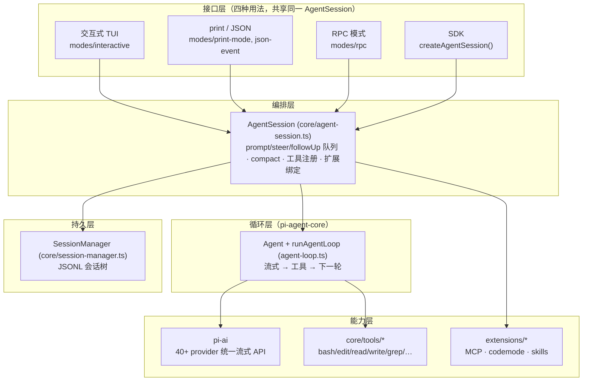

### 1.3 主要功能清单

| 功能 | 说明 | 详见 |
|---|---|---|
| 交互式 TUI | 终端全功能使用（编辑器、主题、键位、小部件） | [4.6](#46-tui-包简) |
| print / JSON 模式 | 脚本与管道：单轮或事件流 | [4.5](#45-四种运行模式对比) |
| RPC 模式 | stdio JSONL，供前端/工具集成 | [4.5](#45-四种运行模式对比) |
| SDK | `createAgentSession()` 组装自己的 agent | [3.2](#32-prompt-生命周期最重要的一条流程) |
| 多 provider 支持 | 40+ 供应商统一流式 API，含 extended thinking | [3.7](#37-ai-层一次模型请求流) |
| 内置工具 | bash / edit / read / write / grep / find / ls / powershell | [3.4](#34-工具执行) |
| 会话树 | append-only JSONL 树，随时 branch / fork / 恢复 | [3.5](#35-会话持久化jsonl-会话树) |
| 自动 compaction | 上下文要满时自动折叠摘要 | [3.6](#36-compaction上下文压缩) |
| 扩展系统 | 事件 + 钩子 + 注册工具/命令/UI | [4.1](#41-扩展系统) |
| MCP | mcp.json 声明外部工具 | [4.2](#42-mcp-接入) |
| Codemode / Tool Search | 脚本调用工具与按需发现工具（默认关闭的内置扩展） | [4.3](#43-codemode-与-tool-search按需暴露工具) |
| Skills / slash 命令 | 提示词工程与命令扩展 | [4.4](#44-skills-与-slash-命令简) |
| 评测 | pi-evals 行为回归评测 | [2.2.6](#226-其余包速览) |

### 1.4 推荐阅读路线

**半天上手**（只读本章）。读完你应该能回答：

- pi 由哪几个包组成、各自干什么、代码在哪？
- 用户敲一条 prompt 后，代码大致怎么走？
- 会话存在哪、compaction 什么时候触发？
- 我想加一个自定义工具/命令，该往哪写？

**继续深入**（按需）：

| 部分 | 读完你能回答 |
|---|---|
| [2. 架构与代码映射](#2-架构与代码映射) | 13 个包的依赖关系与内部结构？某功能在哪个文件？`npm run check` 都查了什么？ |
| [3. 核心执行流程](#3-核心执行流程) | 从 `cli.ts` 到一条回复的完整调用链？agent loop 的双循环？工具如何被拦截？compaction 全流程？ |
| [4. 进阶主题与开发指南](#4-进阶主题与开发指南) | 怎么写扩展？事件和钩子差别？MCP 工具怎么注册进 pi？durable harness 是什么？ |

建议顺序：2（结构感）→ 3（动态感）→ 4（扩展与工程实践）。读第 3 章时对照源码走一遍调用链收益最大。

### 1.5 术语表

| 术语 | 含义 |
|---|---|
| **Agent** | pi-agent-core 的 `Agent` 类，持有消息状态与 steering/followUp 两个队列，驱动 agent loop |
| **Turn / 轮** | 一次模型请求及其工具执行的完整过程；有 toolCall 或 steering 就进下一轮 |
| **Session / Entry / Leaf** | 会话是 append-only 的 entry 树（JSONL）；leaf 决定下一次请求的历史路径 |
| **Branch / Fork** | 把 leaf 移回较早 entry 即分叉（历史不改写）；fork 是复制出独立会话文件 |
| **Compaction** | 上下文接近模型窗口上限时，把早期历史折叠成摘要 entry |
| **Extension** | 普通 TS 模块，通过 `ExtensionAPI`（`pi.` 对象）注册工具/命令/监听事件 |
| **钩子（Hook）** | 返回值能改变流程的扩展事件（block 工具调用、改 systemPrompt、自定义摘要）；纯返回 void 的叫事件 |
| **Steering / FollowUp** | 流式中再来的输入：steer 插入当前轮，followUp 排队下一轮 |
| **Provider / Model** | provider 是一家 LLM 供应商的接入实现；模型目录 `models.generated.ts` |
| **MCP** | Model Context Protocol，外部工具接入标准；pi 内工具名 `mcp__<server>__<tool>` |
| **Skill / Slash 命令** | `/skill:name` 展开的提示词包；`/xxx` 命令（内置或扩展注册） |
| **Lane / Harness / Durable** | 实验性持久化 harness 的概念：车道=会话内并行执行路径，详见 [4.7](#47-durable-实验性-harness) |
| **Doc / 极简核心** | CONTRIBUTING 里的设计原则：核心最小化，能力经扩展 API 承载 |

### 1.6 与英文文档的关系

本文档是**原创导览**，不替代英文文档；每个主题的权威细节在 packages/coding-agent/docs/（40 篇）。对照：

| 本文档章节 | 英文对应（深入阅读） |
|---|---|
| 1（快速上手） | README.md、CONTRIBUTING.md |
| 2（架构与代码映射） | how-pi-works.md、packages.md、docs/UA_ONBOARDING.md（旧版，部分描述已过时） |
| 3（核心执行流程） | how-pi-works.md、session-format.md、compaction.md、message-types.md |
| 4（进阶主题与开发指南） | extensions.md、mcp.md、rpc.md、sdk.md、skills.md、themes.md |

注意：仓库里另有一些迁移前的中文/导览材料（`packages/coding-agent/docs/architecture-zh.md`、`packages/agent/docs/harness-v2-zh.md`、`docs/UA_ONBOARDING.md`），写于 harness 从 pi-agent-core 迁往 pi-durable 之前，其中 `agent-harness.ts`、`runtime/lane.ts`、`session-backends` 等描述已与当前代码不符——本文档以 commit `48dd1e2f0` 为准。

### 1.7 快速开始跑起来

```bash
npm install --ignore-scripts     # 装依赖（不跑生命周期脚本）
npm run check                     # 改代码后必跑的完整校验
npm run build                     # 按依赖序构建所有包
# 开发中跑单个测试（不是全量 vitest！含 e2e）：
# ./test.sh 或在包内 node_modules/vitest --run test/xxx.test.ts
```

CLI 日常（构建后或 `npx pi`）：

```bash
pi                     # 交互式 TUI
pi --print "问题"      # 批处理
pi --mode json "问题"  # JSON 事件流
pi --mode rpc          # stdio JSONL，给前端集成
pi /model              # 会话内 slash 命令示例
```

---

## 2. 架构与代码映射

> 讲 pi 的包结构、每个包的代码组织、功能与代码位置的对应关系。想先建立整体认知，读第 1 章；想看执行流程，跳到 [3. 核心执行流程](#3-核心执行流程)。
>
> 文件路径与行号可能随后续提交漂移。

### 2.1 包依赖总图

13 个包，全部在 `packages/` 下，npm workspaces 管理。依赖方向自下而上：

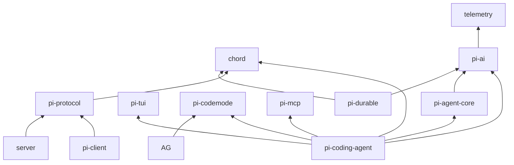

读图要点：

- `chord` 和 `telemetry` 是零内部依赖的地基。
- `pi-ai` 只依赖 `telemetry`，是所有模型交互的必经之路。
- `pi-agent-core`（agent loop 库）只依赖 `pi-ai`。
- `pi-coding-agent` 是依赖最全的顶层产品包，CLI、交互 UI、扩展、会话都在这里。
- `pi-client` / `pi-server` / `pi-protocol` 是远程会话通路，与 coding-agent 主链路无关。
- `pi-evals` 是私有评测包，只在 devDependencies 用 coding-agent，不进依赖图主干。

### 2.2 各包导览

模块 → 仓库路径总对照（npm 名统一带 `@earendil-works/` scope，pi-evals 为 private 不发布）：

| 模块 | 仓库路径 | 一句话 |
|---|---|---|
| **pi-coding-agent** | `packages/coding-agent/` | 主产品：编码 agent CLI |
| **pi-agent-core** | `packages/agent/` | agent 循环库 |
| **pi-ai** | `packages/ai/` | 统一 LLM API |
| pi-tui | `packages/tui/` | 差分渲染终端 UI 库 |
| pi-mcp | `packages/mcp/` | 独立 MCP 客户端库 |
| pi-codemode | `packages/codemode/` | QuickJS-WASM 沙箱 JS 执行 |
| pi-protocol | `packages/protocol/` | 远程会话 CBOR 协议 |
| pi-client | `packages/client/` | 远程会话客户端 |
| pi-server | `packages/server/` | 实验性远程会话服务端 |
| pi-durable | `packages/durable/` | 实验性持久化 harness |
| pi-evals | `packages/evals/` | 行为回归评测 |
| pi-telemetry | `packages/telemetry/` | 遥测契约 |
| chord | `packages/chord/` | 应用组合运行时（零内部依赖地基） |

#### 2.2.1 pi-coding-agent — 主产品包

（路径 `packages/coding-agent/`，见上表。）

**用途**：编码 agent CLI，内置 read/bash/edit/write 工具与会话管理。约 8.3 万行，最大的包。

| 项 | 内容 |
|---|---|
| npm 名 | `@earendil-works/pi-coding-agent` |
| 入口 | `src/index.ts`（SDK facade），bin `pi` → esbuild bundle |
| 依赖 | chord、pi-agent-core、pi-ai、pi-codemode、pi-mcp、pi-tui |

src 一级结构：

| 目录 | 职责 |
|---|---|
| `src/cli.ts` | shebang 入口，仅 `setupCli()` + `main()` 两行 |
| `src/main.ts` | 解析 CLI 参数 → `AgentSessionRuntime` → 四模式分发 |
| `src/core/` | **大脑**：agent-session、session-manager、compaction、tools、extensions |
| `src/modes/` | 四种运行模式：interactive / print-mode / rpc / json-event |
| `src/modes/interactive/interactive-mode.ts` | TUI 交互模式编排，6934 行，最大单文件 |
| `src/extensions/` | 内置扩展：mcp、codemode、tool-search、llama |
| `src/client/` | RPC 客户端胶水 |
| `src/experimental/` | 实验代码（session-worker 等） |
| `src/utils/` | 工具函数 |
| `src/config.ts` | **唯一资源路径来源**，勿用 `__dirname` |

关键文件（行数为 commit 48dd1e2f0 时的量级）：

| 文件 | 行数 | 职责 |
|---|---|---|
| `src/core/agent-session.ts` | 4348 | AgentSession 编排大脑 |
| `src/core/package-manager.ts` | 2760 | 扩展/包管理 |
| `src/core/extensions/types.ts` | 2245 | 扩展作者公共 API 契约 |
| `src/core/session-manager.ts` | 2013 | JSONL 会话树持久化 |
| `src/modes/interactive/interactive-mode.ts` | 6934 | TUI 模式 |

详见 [3. 核心执行流程](#3-核心执行流程)（prompt 生命周期、工具执行、compaction）与 [4. 进阶主题](#4-进阶主题与开发指南)（扩展系统、MCP、四模式对比）。

#### 2.2.2 pi-agent-core — agent loop 库

**用途**：通用 agent 库（npm 名 `@earendil-works/pi-agent-core`）。**很薄**：约 2500 行，6 个平铺文件，无子目录。

| 文件 | 行数 | 职责 |
|---|---|---|
| `src/agent-loop.ts` | 940 | **真正的 agent 循环**：流式 → 工具 → 下一轮 |
| `src/agent.ts` | 613 | Agent 类：消息状态 + steering/followUp 队列 |
| `src/types.ts` | 529 | 循环配置与事件类型 |
| `src/proxy.ts` | 406 | 传输代理抽象 |
| `src/stream-fn.ts` | - | StreamFn 契约 |

**易混淆点**：这个包**没有** `agent-harness.ts`、`runtime/`、`AgentLane`。harness 概念在 `pi-durable` 里（见 [4.7](#47-durable-实验性-harness)）。旧文档（`docs/UA_ONBOARDING.md`、`packages/agent/docs/harness-v2-zh.md` 等）写于架构迁移前，描述的 `agent-harness.ts`、`session-backends` 已不存在；读旧材料时注意以这部分为准。

#### 2.2.3 pi-ai — 统一 LLM API

**用途**（npm 名 `@earendil-works/pi-ai`）：统一多供应商 LLM API，自动模型发现与 provider 配置。约 2.6 万行。

结构：

| 目录/文件 | 职责 |
|---|---|
| `src/api/` | 协议实现：anthropic-messages.ts（1646 行）、openai-completions.ts（1726 行）、openai-codex-responses.ts（1697 行）、google-generative-ai.ts、bedrock-converse-stream.ts 等 |
| `src/providers/` | Provider 工厂 + 静态模型表，每家两个文件：anthropic.ts + anthropic.models.ts |
| `src/providers/all.ts` | 聚合全部 provider（40+ 家） |
| `src/models.generated.ts` | **脚本生成的总模型目录，勿手改**（见下） |
| `src/auth/`、`src/oauth.ts` | 认证 |
| `src/types.ts` | 统一消息/流事件类型，`streamSimple` 契约 |

`models.generated.ts` 由 `packages/ai/scripts/generate-models.ts` 生成（根 `npm run generate:models`）。改上游元数据要改脚本再重新生成，把生成 diff 一起提交是允许的。

详见 [3.7 AI 层](#37-ai-层一次模型请求流)。

#### 2.2.4 pi-tui — 终端 UI 库

**用途**（npm 名 `@earendil-works/pi-tui`）：差分渲染的终端组件库。约 1.9 万行，含 darwin/linux/win32 原生模块（剪贴板等，根 `build:native:*` 脚本）。

| 文件 | 行数 | 职责 |
|---|---|---|
| `src/components/editor.ts` | 2472 | 行编辑器 |
| `src/tui-alt-screen.ts` | 1755 | alt-screen 渲染器 |
| `src/tui.ts` | 1493 | TUI 主体 |
| `src/keys.ts` | 1401 | 按键解析 |
| `src/keybindings.ts` | - | 可配置键位（DEFAULT_EDITOR_KEYBINDINGS 等） |

无内部依赖，被 coding-agent 消费。

#### 2.2.5 pi-durable — 实验性持久化 harness

**用途**（npm 名 `@earendil-works/pi-durable`）：会话、任务、文档的持久化运行时——**先落存储再执行，崩溃可恢复**。约 1.77 万行。

| 目录 | 职责 |
|---|---|
| `src/harness/` | 持久化 harness：scheduler.ts（1337 行）、harness.ts、lane 相关 |
| `src/session/` | 会话树、车道（lane）、操作日志 |
| `src/storage/` | memory / jsonl / sqlite 三种后端 + conformance 测试 |
| `src/tools/`、`src/env/` | 工具与环境 |
| `src/testing/` | storage-conformance.ts（1583 行） |

**实验性，API 高度可变**。详见 [4.7](#47-durable-实验性-harness)。

#### 2.2.6 其余包（速览）

| 包 | npm 名 | 用途 | 量级 |
|---|---|---|---|
| `packages/chord` | `@earendil-works/chord` | 应用组合运行时：服务、复制状态、RPC、插件。零依赖地基 | 5000+ 行，delta/tracker.ts 2205 行 |
| `packages/protocol` | `pi-protocol` | 传输无关 CBOR 编码协议 | 869 行，最小包 |
| `packages/client` | `pi-client` | 帧化 CBOR 客户端，连远程 pi 会话 | 约 1100 行 |
| `packages/server` | `pi-server` | 实验性 pi 服务端 + session-router | 约 2000 行 |
| `packages/mcp` | `pi-mcp` | 独立 MCP 客户端库（stdio / streamable-http 传输） | 约 3100 行 |
| `packages/codemode` | `pi-codemode` | QuickJS-WASM 沙箱 JS 执行，唯一能力是调注入的工具 | 约 1600 行 |
| `packages/telemetry` | `pi-telemetry` | 厂商中立遥测契约 | 935 行 |
| `packages/evals` | `pi-evals` | 行为评测（vitest-evals + Docker 沙箱），不发布 | 约 1400 行 |

### 2.3 功能 ↔ 代码映射总表

| 功能 | 位置 | 关键入口 |
|---|---|---|
| CLI 启动 | `coding-agent/src/cli.ts` → `main.ts` | `main()` main.ts:573 |
| 模式判定 | `coding-agent/src/main.ts` | `resolveAppMode()` main.ts:112 |
| 交互式 TUI | `coding-agent/src/modes/interactive/` | `InteractiveMode` interactive-mode.ts:436 |
| print / JSON 模式 | `coding-agent/src/modes/print-mode.ts`、`json-event.ts` | `runPrintMode()` |
| RPC 模式 | `coding-agent/src/modes/rpc/rpc-mode.ts` | `runRpcMode()` rpc-mode.ts:54 |
| SDK 组装 | `coding-agent/src/sdk.ts` | `createAgentSession()` |
| 会话编排 | `coding-agent/src/core/agent-session.ts` | `AgentSession.prompt()` agent-session.ts:1921 |
| agent 循环 | `agent/src/agent-loop.ts` | `runAgentLoop()` agent-loop.ts:102 |
| 内置工具 | `coding-agent/src/core/tools/` | `createCodingTools()` tools/index.ts:195 |
| 会话持久化 | `coding-agent/src/core/session-manager.ts` | `SessionManager._persist()` session-manager.ts:1172 |
| 上下文压缩 | `coding-agent/src/core/compaction/` | `shouldCompact()` compaction.ts:267 |
| 扩展系统 API | `coding-agent/src/core/extensions/types.ts` | `ExtensionAPI` types.ts:1540 |
| 扩展加载 | `coding-agent/src/core/extensions/loader.ts`（jiti） | loader.ts |
| MCP 接入 | `coding-agent/src/extensions/mcp/index.ts` | `registerTools()` mcp/index.ts:349 |
| 多 provider | `ai/src/api/` + `ai/src/providers/` | `streamSimple` |
| 模型目录 | `ai/src/models.generated.ts`（生成） | 脚本 `ai/scripts/generate-models.ts` |
| 终端 UI | `tui/src/` | `TUI` tui.ts |
| 远程会话 | `protocol` + `client` + `server` | CBOR 帧协议 |
| 评测 | `evals/` | vitest-evals |
| 遥测 | `telemetry/src/index.ts` | 契约类型 |

### 2.4 根目录速查

| 路径/命令 | 说明 |
|---|---|
| `npm run check` | biome（自动修 + 警告即失败）→ 6 个自定义校验脚本（pinned-deps、runtime-deps、ts-imports、entry-graphs、shrinkwrap、install-lock）→ `tsc --noEmit` → browser-smoke。**改代码后必跑，修复全部 error/warning/info** |
| `./test.sh`（仓库根） | 非 e2e 测试入口。**不要直接跑 vitest 全量**：包含会在有 endpoint/auth 环境变量时激活的 e2e 测试 |
| 单测（vitest 包内跑） | `node "$(git rev-parse --show-toplevel)/node_modules/vitest/dist/cli.js" --run test/xxx.test.ts` |
| `tui` 包测试 | node:test：`node --test test/xxx.test.ts` |
| `npm run build` | 按依赖序逐包构建：chord → tui → telemetry → codemode → mcp → ai → durable → agent → protocol → client → server → coding-agent |
| 依赖安装 | 本地 `npm install --ignore-scripts`；干净环境 `npm ci --ignore-scripts`。**不要跑生命周期脚本** |
| 版本 | 所有包统一版本 `0.99.2`；`npm run version:patch/minor` 同步 |
| CHANGELOG | `packages/*/CHANGELOG.md` 每包一份，新条目进 `## [Unreleased]` |
| 提交 | 只 stage 自己改的文件；格式 `{feat,fix,docs}[(ai,tui,agent,coding-agent)]: 消息`；lockfile 提交需 `PI_ALLOW_LOCKFILE_CHANGE=1` |
| 发布 | `.pi/skills/release.md` 流程文档 |

---

## 3. 核心执行流程

> 讲 pi 从启动到一次对话完成的全链路：CLI 入口、prompt 生命周期、agent 循环、工具执行、会话持久化、compaction、模型请求流。包结构见 [2. 架构与代码映射](#2-架构与代码映射)，扩展/MCP 见 [4. 进阶主题](#4-进阶主题与开发指南)。
>
> 行号可能随后续提交漂移。

### 3.1 CLI 启动与模式分发

入口链只有三层，职责清晰："CLI 解析参数，SDK 做重活"。

```
pi (bin) → dist/bundle/cli.js (esbuild 产物)
         → src/cli.ts（shebang，两行）
         → src/main.ts 的 main()（main.ts:573）
```

`main()` 解析参数、初始化 settings 与 `ModelRuntime`，由 `resolveAppMode()`（main.ts:112）判定运行模式：

| 条件 | 模式 | 实现 |
|---|---|---|
| `--mode rpc` | rpc | `runRpcMode()`（modes/rpc/rpc-mode.ts:54），stdio 上的 JSONL |
| `--mode json` | json | print 模式变体，输出 JSON 事件流 |
| `--print` 或非 TTY | print | `runPrintMode()`（modes/print-mode.ts:33），批处理 |
| 其余（TTU 交互） | interactive | `new InteractiveMode(runtime,...).run()`（interactive-mode.ts:436） |

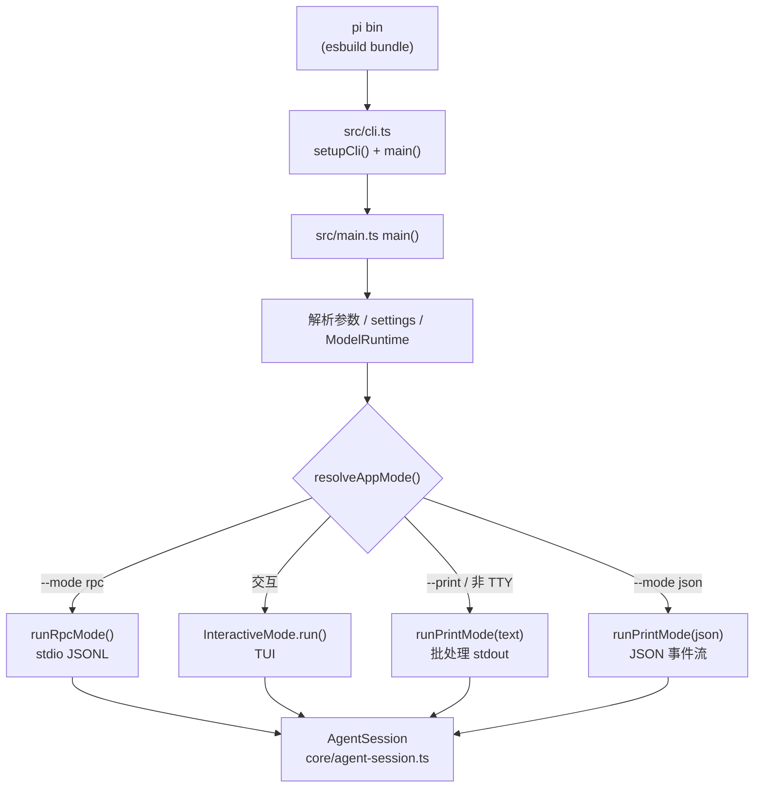

四种模式都经由 `AgentSessionRuntime`（core/agent-session-runtime.ts）创建并持有同一个 `AgentSession`——所有上层入口共享同一套编排逻辑，模式只决定"输入从哪来、输出怎么呈现"。

### 3.2 Prompt 生命周期（最重要的一条流程）

用户敲入一条消息后发生的事。起点 `AgentSession.prompt()`（core/agent-session.ts:1921）：

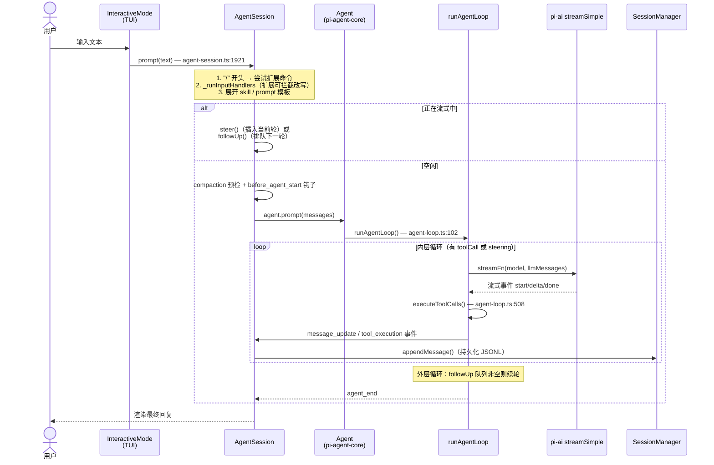

`prompt()` 内部顺序要点（agent-session.ts:1921-1984）：

1. `/` 开头的输入先尝试扩展命令（扩展命令自行管理 LLM 交互）。
2. `_runInputHandlers`：扩展输入处理器可拦截或改写输入（返回空则终止）。
3. 展开 `/skill:name` 与 `/template` 提示词模板。
4. **流式中再来的输入**：必须指明 `streamingBehavior`——`steer`（插进当前轮）或 `followUp`（排队下一轮），落到 `Agent` 的两个队列。
5. 空闲时：校验模型与鉴权 → compaction 预检 → 发 `before_agent_start` 钩子（扩展可改 systemPrompt/model）→ 进入 agent loop。

AgentSession 全程订阅 agent 事件（`agent.subscribe`），`message_end` 时把消息写进 SessionManager。

**图里的 "pi-ai streamSimple" 是什么**：pi-ai 的统一流式请求入口，定义于 `ai/src/types.ts:288`（`ProviderStreams` 接口）：

```ts
streamSimple(model, context, options): AssistantMessageEventStream
```

`context` 是简单结构 `{ systemPrompt?, messages, tools? }`；返回统一事件流（start / text_delta / thinking_delta / toolcall / done…）。`ai/src/api/` 下每个协议实现（anthropic-messages.ts、openai-completions.ts…）都导出自己的 `streamSimple`，负责把统一格式转成该家 API 格式并解析该家 SSE；coding-agent 的 `ModelRuntime.streamSimple`（core/model-runtime.ts:715）再包一层鉴权解析与虚拟模型路由。agent loop 只面向这一个签名，不认识任何具体厂商——这就是"40+ 家 provider、循环零 if"的解耦点。详见 [3.7 AI 层](#37-ai-层一次模型请求流)。

### 3.3 Agent Loop 内部：双循环

`runAgentLoop()`（agent/src/agent-loop.ts:102）→ `runLoop()`（agent-loop.ts:163）。结构是**外层跟 followUp，内层跟 toolCall/steering**：

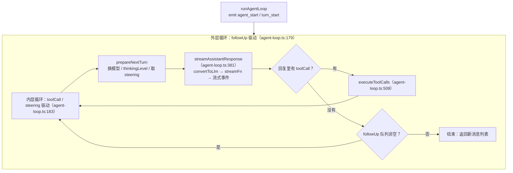

- 每轮的流式响应把 `AgentMessage[]` 在 LLM 边界转换成 provider 的 `Message[]`（`convertToLlm`，agent-loop.ts:395），收到的事件（text/thinking/toolcall 的 start-delta-end）逐个转成 `message_update` 发出来。
- 输出 token 截断的消息，其工具调用不执行、全部报错（agent-loop.ts:478）。
- AgentSession 侧在 `_runAgentPrompt` 里还有一个 while 循环调 `agent.continue()`（agent-session.ts:1789），处理失败重试与 compaction 后续轮。

### 3.4 工具执行

工具从哪来：`createCodingTools()`（core/tools/index.ts:195）统一创建 8 个内置工具。工具定义在 `core/tools/`：

| 工具 | 文件 |
|---|---|
| edit / edit-diff | edit.ts（edit.ts:218 `createEditTool`）、edit-diff.ts |
| read | read.ts（read.ts:201 `createReadTool`） |
| bash | bash.ts（经 core/bash-executor.ts 执行） |
| write | write.ts |
| grep / find / ls / powershell | grep.ts、find.ts、ls.ts、powershell.ts |
| 辅助 | truncate.ts（输出截断）、output-accumulator.ts、file-mutation-queue.ts、renderers/ |

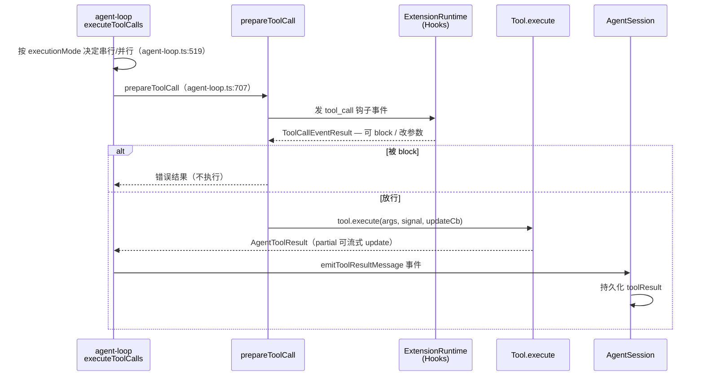

要点：

- 默认**并行**执行；任一工具声明 `executionMode: "sequential"` 或配置为 sequential 时整批串行（agent-loop.ts:519）。
- `tool_call` 钩子可以**拦截**：改参数或直接 block（见 [4.1.1 事件 vs 钩子](#411-事件-vs-钩子关键区别)）。
- 扩展注册的工具走同一管线（`pi.registerTool()` 注入，包装见 tool-definition-wrapper.ts），权限检查与钩子行为一致。
- MCP 工具也在这里汇入——见 [4.2 MCP 接入](#42-mcp-接入)。

### 3.5 会话持久化：JSONL 会话树

`SessionManager`（core/session-manager.ts:987）——"append-only 树存储在 JSONL 文件"。无数据库，Schema 见 packages/coding-agent/docs/session-format.md。

存储布局：

```text
~/.pi/agent/sessions/<编码后的 cwd>/
  <session-id>.jsonl      每行一个 SessionEntry
```

（`~/.pi/agent/` 下的 models.json、auth.json、settings.json 等路径 helpers 都来自 core/config.ts 的 `getAgentDir()`。）

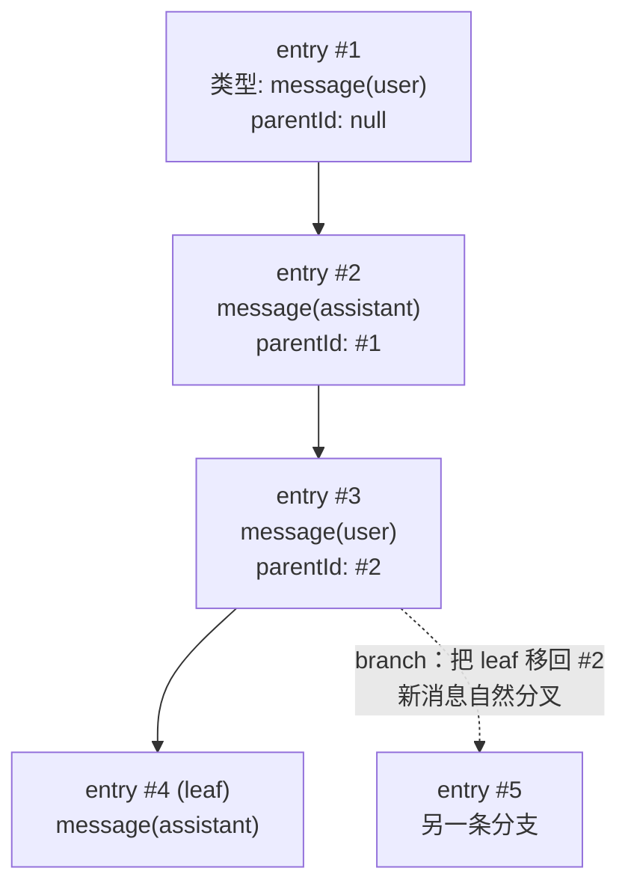

- **树结构**：每条 entry 有 `id` / `parentId`（session-manager.ts:182）；追加即成为当前 leaf 的孩子（`_appendEntry`，session-manager.ts:1191）。
- **branching**：把 leaf 指针移回更早的 entry，新消息自然分叉；历史不改写。`getBranch(fromId)` 沿 parentId 回溯到根得到当前分支（session-manager.ts:1469）。
- **写盘**：`_persist()`（session-manager.ts:1172）——文件只用 `openSync(wx)` 创建一次并全量 flush 已积压 entries，之后 `appendFileSync` 逐行追加。对话发生（有 user/assistant message）才建文件，防止空会话垃圾（session-manager.ts:1166）。
- **fork**：`parentSession` 字段让新会话文件指向父会话。
- compaction 摘要、branch summary 也是 entry 类型（顶层 entry，经 `appendCompaction()` / `appendBranchSummary()` 写入，不能用 `appendMessage` 直接写）。
- `buildSessionContext()`／`buildSessionProjection()`（session-manager.ts:987 注释）：从 root 到 leaf 沿路径解析出给 LLM 的消息列表（含 compaction 摘要折叠）。

### 3.6 Compaction：上下文压缩

目的：会话太长时，把早期历史折叠成摘要，控制在模型 contextWindow 内。纯逻辑在 `core/compaction/compaction.ts`。

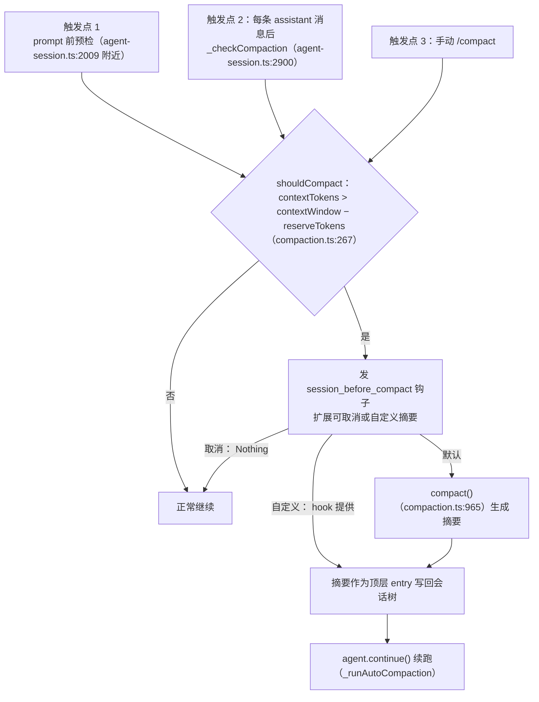

- 判定式很直白：`contextTokens > contextWindow - reserveTokens`（compaction.ts:267）；token 用 chars/4 保守估算。
- `_checkCompaction`（agent-session.ts:2900）区分三种自动情形：失败消息触发"压缩+重试一轮"、成功但 overflow（压缩、保留已完成的回复）、单纯跨阈值（只压缩）。旧模型的 overflow 不会给新模型触发压缩。
- 用户可显式 `/compact`；钩子可以取消或**替换整个压缩流程**（自定义摘要）。
- compaction 后续轮会走 `agent.continue()`，这就是上面 agent loop 双循环里 `prepareNextTurn` 之后的续轮。

### 3.7 AI 层：一次模型请求流

pi 怎么同时支持 40+ 家 provider：**接口单一化（`streamSimple` 契约）+ 每家两个文件**。

| 文件 | 角色 |
|---|---|
| `ai/src/types.ts:288` | `streamSimple` 契约：统一入参（model + messages + options），输出统一流事件 |
| `ai/src/providers/anthropic.ts` | Provider 工厂（模型表 + 认证 + 选 API 实现） |
| `ai/src/providers/anthropic.models.ts` | 该家的静态模型元数据（contextWindow、价格…） |
| `ai/src/api/anthropic-messages.ts` | 该家协议实现（HTTP + SSE 解析 → 统一事件） |
| `ai/src/providers/all.ts` | 聚合所有 provider（40+） |
| `ai/src/models.generated.ts` | 全家模型总目录（脚本生成） |

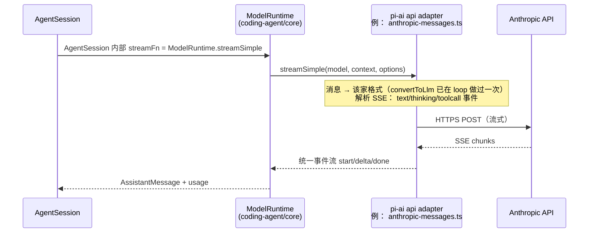

要点：

- coding-agent 侧的统一入口是 `ModelRuntime.streamSimple`（core/model-runtime.ts），`sdk.ts:387` 把它注入 Agent 作为 `streamFn`；agent loop 对 provider 一无所知。
- extended thinking：请求级 `reasoning` 配置从 `AgentLoopConfig` 传入，`prepareNextTurn` 可按轮改（agent-loop.ts:193）。
- 厂商适配的细节（Bedrock 帧格式、azure 前缀、copilot 头等）全部封装在 `api/` 对应文件里；加新 provider = 新增 providers/ 两文件 + api/ 实现并在 all.ts 注册。
- 认证：`auth/` + oauth.ts 处理 token 刷新；loop 在每次请求前经 `getApiKey` 解析（可过期）凭证（agent-loop.ts:400）。

---

## 4. 进阶主题与开发指南

> 讲扩展系统、MCP、运行模式对比、TUI、实验性 durable harness，以及日常开发工作流。基础架构见 [2. 架构与代码映射](#2-架构与代码映射)，核心流程见 [3. 核心执行流程](#3-核心执行流程)。
>
> 行号可能随后续提交漂移。

### 4.1 扩展系统

pi 的扩展是普通 TS 模块，通过 `ExtensionAPI` 与 pi 交互。API 契约在 `coding-agent/src/core/extensions/types.ts`：`ExtensionAPI`（types.ts:1540）、完整 `Extension` 结构（types.ts:2210）。

扩展能做什么（`pi.` 上的注册动作）：

| 动作 | 说明 |
|---|---|
| `on(event, handler)` | 订阅事件/钩子（见下） |
| `registerTool()`（types.ts:1619） | 注入自定义工具 |
| `registerCommand()`（types.ts:1628） | 注册 `/` 命令 |
| `registerMcpServer()`（types.ts:1839） | 注册 MCP server |
| `setWidget()`（types.ts:188） | TUI 上的小部件 |
| `sendMessage()` | 扩展自行发起 LLM 交互 |

加载与运行：`core/extensions/loader.ts`（jiti 编译 TS，支持热重载）+ `runner.ts`（`ExtensionRuntime`，types.ts:2205）。内置扩展示例在 `src/extensions/`（mcp、codemode、tool-search、llama）。

#### 4.1.1 事件 vs 钩子（关键区别）

都是 `pi.on()` 订阅，**区别在 handler 返回值**：

| 类型 | 返回值 | 例子 |
|---|---|---|
| 事件（纯通知） | void，只观察 | `session_start`、`agent_end`、`turn_start` |
| 钩子（可拦截） | 结果对象，**能改变流程** | 见下表 |

三个最有用的钩子：

| 钩子 | 能做什么 | 契约位置 |
|---|---|---|
| `tool_call` | 改参数或 **block** 工具调用 | types.ts:1142、1609 |
| `before_agent_start` | 改 systemPrompt、换模型 | types.ts:900、1587 |
| `session_before_compact` | 取消压缩或提供自定义摘要 | types.ts:752、1561 |

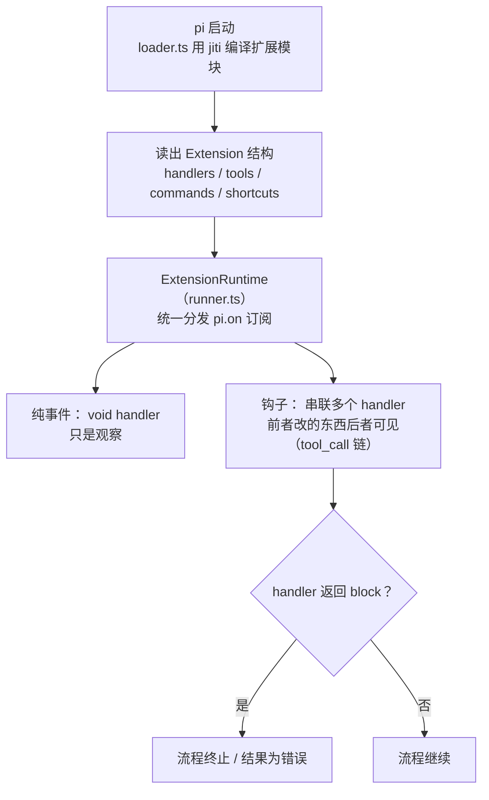

写扩展：完整文档见 packages/coding-agent/docs/extensions.md；带依赖扩展示例在 packages/coding-agent/examples/extensions/。

### 4.2 MCP 接入

两层结构：`packages/mcp` 是**独立通用 MCP 客户端库**（npm 名 `pi-mcp`，可脱离 pi 用），coding-agent 的扩展 `src/extensions/mcp/index.ts` 负责接线。

- 传输：`mcp/transports/`——stdio、streamable-http（500 行）、in-memory；OAuth 流程在 `mcp/oauth/`。
- 配置：`mcp.json`，由 coding-agent core/config.ts:115 `loadMcpConfig()` 读取。

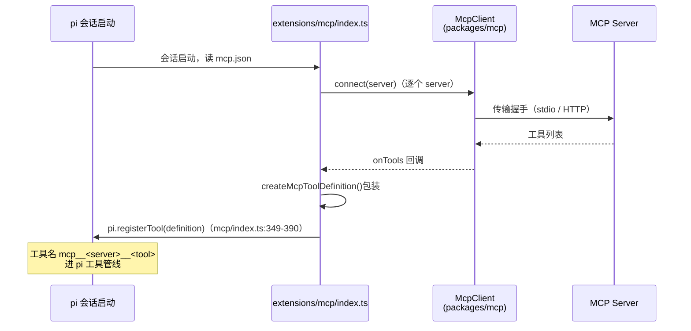

要点：

- 工具名统一 `mcp__<server>__<tool>`，重名自动加 hash 后缀保证稳定（mcp/index.ts:365）。
- **四种 exposure**：direct（模型直接用）/ codemode（沙箱里调）/ deferred（按需拉取）/ hidden（隐藏）。server 掉线的工具再注册为 hidden（不能反注册）。
- MCP 调用走 pi 自身工具管线——`tool_call` 钩子、权限检查照常生效。

### 4.3 Codemode 与 Tool Search：按需暴露工具

两个**默认关闭**的内置扩展（`src/extensions/codemode/`、`src/extensions/tool-search/`，`defaultActive: false`），解决同一个矛盾：工具很多时，不可能全塞进系统提示词。注意：**注册层与执行层完全不变**——它们只改"声明层"（模型看见什么）。

```text
┌─ 注册层: 所有 registerTool 进来的工具（内置 / MCP / 扩展）── 不受影响
├─ 声明层: 系统提示词里列出的工具               ← codemode / tool_search 改这层
└─ 执行层: prepareToolCall → tool_call 钩子 → execute ── 永远同一条管线
```

#### 4.3.1 codemode——模型写 JS 调工具

开启（`settings.json` 的 `"defaultTools": ["+codemode"]`，或单次 `pi --tools read,bash,edit,write,codemode`）后，模型多一个 `codemode` 工具：**模型不再逐个调工具，而是写一段 JavaScript 在 QuickJS-WASM 沙箱（pi-codemode 包）里执行，脚本中并发调用其他工具**：

```js
const [a, b, c] = await Promise.all([
  tools.read("a.ts"), tools.read("b.ts"), tools.read("c.ts"),
]);
return { sizes: [a.length, b.length, c.length] };
```

关键行为（见 extensions/codemode/tool.ts:1-21 头注释、docs/cli.md#enable-codemode）：

- **嵌套调用走正规管线**：脚本里的 `tools.read(...)` 经 `ctx.executeTool()` 进入 agent loop 工具管线，`tool_call` 钩子、参数校验、权限检查与直接调用完全一致。
- **省 token**：嵌套工具结果只给脚本，**只有脚本返回值到达模型**——并行读 10 个文件只回传一个汇总。
- **脚本环境**：`tools.*`（调用工具）、`searchTools(query)`（BM25 检索，与 tool_search 共用打分器）、`describeTool/describeNamespace`、`store()/load()`（跨脚本持久化为 `codemode-store` 会话 entry，分支各自可见）、`models.*`（模型目录 + 分类器）。工具声明进 codemode 描述，预算 3000 token（`codemode.inlineBudget`）。
- **`codemode.mode` 决定内置工具的去留**：`on`（默认）内置工具照常声明 + 多一个 codemode 工具，双轨；`only` 内置工具从系统提示词**隐藏**、只能在脚本里调，工具清单坍缩到基本只剩 codemode 一个——适合 MCP 工具爆炸的场景。

技术上 codemode 只用了三个一等公民原语：`prepareLoadout` 钩子 + exposure 字段 + `ctx.executeTool()`（docs/extensions.md）——没有为它加任何特殊管线，另一个工具用同样原语可以实现同样行为。

#### 4.3.2 tool_search——工具的搜索引擎

解决另一个缺口：`deferred` 工具（主要是未激活的 MCP 工具）**完全不声明**给模型，模型不知道其存在、没有调用入口。

```text
模型: tool_search("jira 创建工单")
  → BM25 对工具元数据打分排序（extensions/tool-search/tool.ts:118）
  → 命中的工具在【下一轮】声明给模型
  → 之后模型直接调用，管线与内置工具一致
```

要点：

- **只做发现，不执行**：一次搜索改变下一轮的工具面板（tool-search/tool.ts:197）。
- BM25 打分器同时被 codemode 脚本的 `searchTools()` 复用，两个扩展共享同一检索层。
- 自身描述刻意极短（不列工具名单，只说"找 MCP 工具用我"），避免自我膨胀（tool-search/tool.ts:217）。
- 配了 MCP server 时 MCP 扩展会自动激活它；也可手动 `--tools`/`defaultTools` 开启。

#### 4.3.3 与 MCP、内置工具的关系（回顾 4.2）

| | 不开两者 | 开 codemode | 开 tool_search | 两个都开 |
|---|---|---|---|---|
| 注册层 / 执行层 | — | 不变 | 不变 | 不变 |
| MCP 工具进模型视野 | 不会（默认 codemode exposure） | 进 codemode 描述声明清单，脚本里调 | 被搜到后**下一轮直接声明** | 搜到后直调，或脚本 `searchTools` |
| 内置工具 | 直接声明 | `on` 照旧 / `only` 藏进脚本 | 照旧 | 取决于 `codemode.mode` |
| 系统提示词大小 | 全量声明 | +codemode 声明（≤3000 token） | +tool_search 一小段 | 由 mode 决定 |

### 4.4 Skills 与 Slash 命令（简）

- **Skills**：`/skill:name` 语法展开为提示词（见 core/agent-session.ts:1961 `_expandSkillCommand`）；仓库自己的 skill 在 `.pi/skills/`（如 release.md、interactive-testing.md）。文档见 packages/coding-agent/docs/skills.md。
- **Slash 命令**：内置命令 + 扩展 `registerCommand()` 注册的命令。内置清单见 packages/coding-agent/docs/slash-commands.md。
- **Prompt 模板**：`/template args` 展开（同在 prompt() 早期处理）。

### 4.5 四种运行模式对比

| 模式 | 何时 | 输入 | 输出 | 入口 |
|---|---|---|---|---|
| interactive | 人工终端使用 | TUI 编辑器 | 终端 UI | modes/interactive/interactive-mode.ts:436 |
| print（text） | 脚本/管道 | argv 或 stdin | stdout 纯文本 | modes/print-mode.ts:33 |
| print（`--mode json`） | 程序消费事件流 | 同上 | stdout JSON 事件 | modes/json-event.ts |
| rpc | 前端/工具集成 | stdin JSONL 命令 | stdout JSONL 事件 | modes/rpc/rpc-mode.ts:54 |

RPC 相关文档：docs/rpc.md、rpc-commands.md、rpc-extension-ui.md；SDK 用法见 docs/sdk.md。

#### 4.5.1 远程会话架构（client / protocol / server）

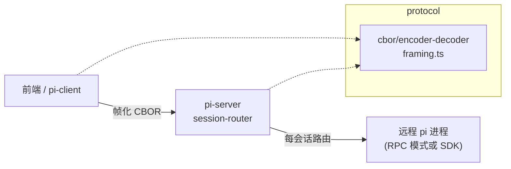

- `pi-protocol`：CBOR 编解码 + 帧协议（framing.ts），共 869 行。
- `pi-server`（实验性）：`server.ts` + `session-router.ts` 路由会话；Unix socket 传输在 `transports/unix/listener.ts`。
- `pi-client`：连接远程会话的客户端（client.ts:479 的主体）。

### 4.6 TUI 包（简）

`pi-tui` 是独立终端组件库：差分渲染（只重绘变化区域）、alt-screen（tui-alt-screen.ts:1755）、行编辑器（components/editor.ts:2472）、按键协议解析（keys.ts:1401，支持 Kitty protocol）、可配置键位（`DEFAULT_EDITOR_KEYBINDINGS` / `DEFAULT_APP_KEYBINDINGS`——改键位默认值要改这里，不要硬编码按键判断）。原生模块（darwin/linux/win32）提供剪贴板等能力。

pi 交互模式 = 交互模式编排（interactive-mode.ts，6934 行）+ pi-tui 组件 + 主题系统（theme/）。主题与键位文档见 packages/coding-agent/docs/themes.md、keybindings.md。

### 4.7 Durable 实验性 Harness

`pi-durable` 是**实验性**的持久化 agent harness（最近提交 48dd1e2f0 刚把它从 pi-agent-core 挪过来，commit f29ea3deb 删掉了 agent 包里的旧 harness）。核心思想：**会话、模型轮次、工具调用先落存储再展示**，进程中途挂掉后恢复续跑。

设计文档（详细版，含 21 章）：packages/agent/docs/harness-v2-zh.md（注意：包路径写的是迁移前，概念仍然有效）。

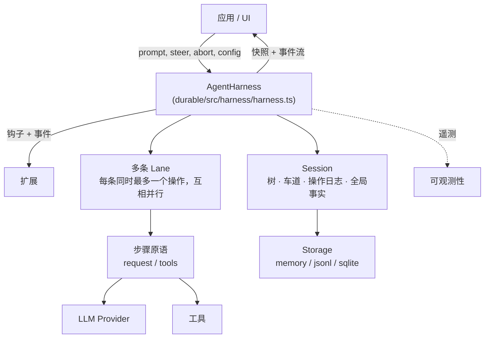

关键概念（相对现有 AgentSession 的差异）：

- **持久化运行**：被接受的 prompt 是持久化操作；崩溃后新进程从上一个安全边界续跑，"无局部结果"。
- **Lane（车道）**：一个 Session 内多条命名对话路径并行执行；运行与其排队消息属于接受它的车道。交互 pi 只用一条车道，不展示该概念；子 agent 工具会用到第二条车道。
- **单写入者**：同一时刻只有一个 harness 写某个 Session。
- **确定性单步**（测试用）：所有效应跨注入边界；`drive: "manual"` 模式可逐步驱动、注入故障、模拟崩溃。
- 存储三种后端 + conformance 测试（testing/storage-conformance.ts:1583）确保后端行为一致。

**定位**：生产用的还是 `coding-agent` 的 AgentSession 链路；durable 是演进方向实验场，API 随时会破。

### 4.8 开发工作流

#### 4.8.1 环境与常用命令

- 要求 Node >= 22.19。装依赖：`npm install --ignore-scripts`（干净环境 `npm ci --ignore-scripts`），不跑生命周期脚本。
- `npm run check`（改代码后必跑，全量输出）：biome（自动修 + 警告即失败）→ 6 个校验脚本 → `tsc --noEmit` → browser-smoke。不跑测试。
- 测试：**不要直接跑 vitest 全量**（含 e2e，有 endpoint/auth 环境变量就会激活）。根 `./test.sh` 跑非 e2e；单个测试在包根跑：
  - vitest：`node "$(git rev-parse --show-toplevel)/node_modules/vitest/dist/cli.js" --run test/xxx.test.ts`
  - tui 包（node:test）：`node --test test/xxx.test.ts`
- coding-agent 的 `test/suite/` 用 harness.ts + faux provider，不碰真实 API。
- 构建：`npm run build` 按依赖序逐包（chord → tui → … → coding-agent）。
- eval：`npm run eval`（pi-evals，vitest-evals 行为评测）。

#### 4.8.2 关键编码规范

完整规则见根 AGENTS.md，最容易踩的：

- **erasable-only TS**：`packages/*/src` 只用可擦除语法——没有 enum、namespace、参数属性、`import =`（node strip-only 模式）。
- **无 inline import**：不用 `await import()` / 动态类型 import，顶层 import。
- **资源路径**：coding-agent 内解析包资源一律走 `src/config.ts` 的 helpers（`getAgentDir()` 等），不用 `__dirname`。
- **models.generated.ts 勿手改**：改 `packages/ai/scripts/generate-models.ts` 再重新生成；带着生成 diff 提交总是允许的。
- **键位**：永不硬编码按键判断（`matchesKey(keyData, "ctrl+x")`），往 `DEFAULT_EDITOR_KEYBINDINGS` / `DEFAULT_APP_KEYBINDINGS` 加默认项。
- **无 backward-compat 垫片**：除非你被明确要求。
- **依赖**：外部依赖精确 pin 版本；lockfile/shrinkwrap 变更视为需 review 的代码；更新 undici 前必读其 changelog。

#### 4.8.3 Git 与提交

- 多个 pi 会话可能同时在同一 cwd 工作：只 commit 本会话自己改的文件，`git add <具体路径>`，永不 `git add -A`。
- 提交格式：`{feat,fix,docs}[(ai,tui,agent,coding-agent)]: 简述`。
- 禁令：`git reset --hard`、`git checkout .`、`git stash`、`--no-verify`、force push。
- lockfile 提交需 `PI_ALLOW_LOCKFILE_CHANGE=1`（pre-commit 会拦）。
- CHANGELOG：每包一份 `packages/*/CHANGELOG.md`，新条目进 `## [Unreleased]` 的对应小节；非 main 分支不写 changelog。

#### 4.8.4 英文文档导航（深处查这个）

最常用的几篇，全部在 packages/coding-agent/docs/：

| 主题 | 文档 |
|---|---|
| 总览 | how-pi-works.md、index.md |
| 配置 | configuration.md、settings.md、environment-variables.md |
| 会话 | sessions.md、session-format.md、compaction.md |
| 扩展 | extensions.md、mcp.md、skills.md、slash-commands.md |
| 模型 | providers.md、models.md、custom-provider.md |
| 模式 | rpc.md（+rpc-commands）、json.md、sdk.md |
| 终端 | tui.md、themes.md、keybindings.md、terminal-setup.md |
