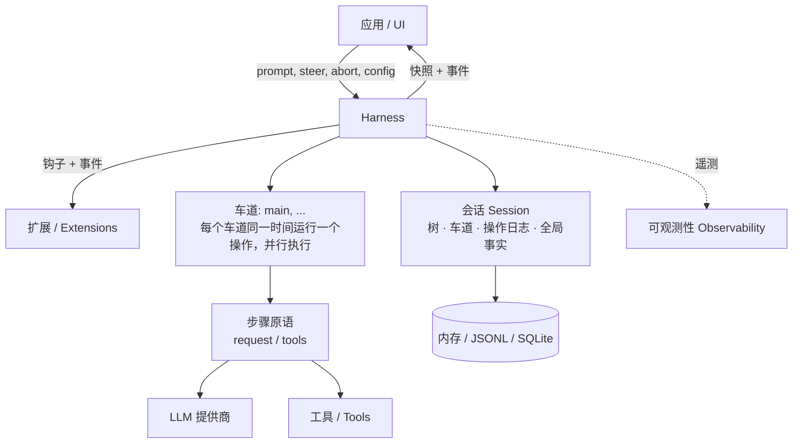
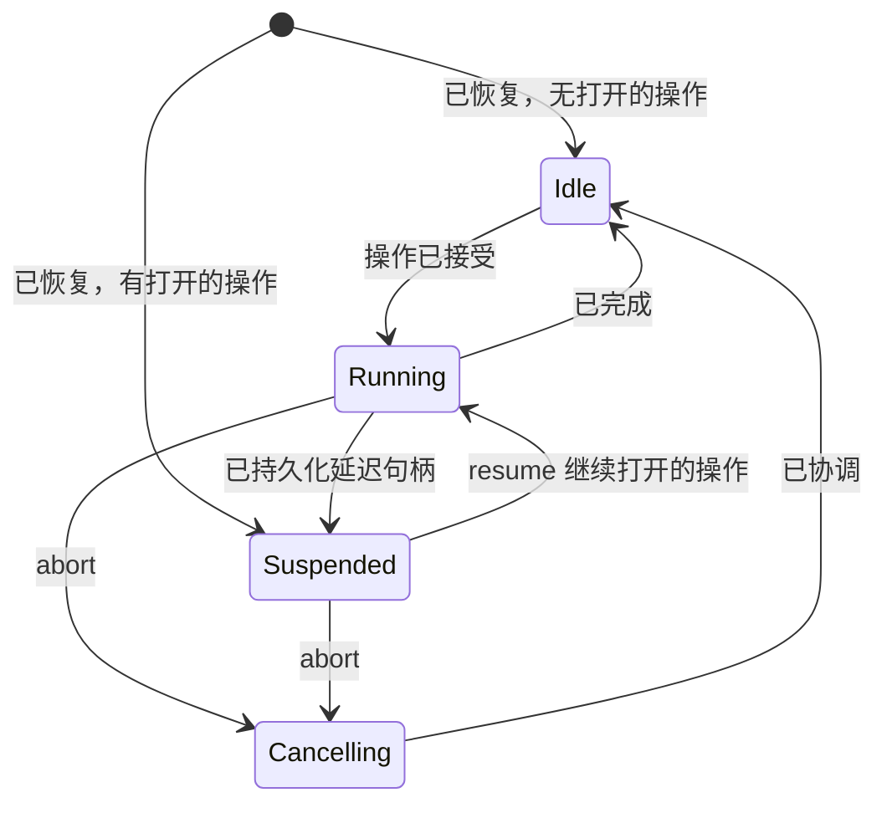

# 持久化 AgentHarness 设计 (Durable AgentHarness design)

> **兼容性策略**。旧版 coding-agent v3 JSONL 会话必须能够打开并恢复为空闲状态。这是唯一的后向兼容性要求。`packages/agent/src/harness` 和 `packages/session-backends/sqlite-node`（及其各自的测试）中的所有其他格式和 API 均可破坏。我们不为其他任何内容编写迁移、模式版本化或转换路径。



Harness 针对单个 Session 执行运行。Session 包含四种状态（第 2 节）。多个车道（Lanes）在单个 Harness 内部并行执行（第 3 节）。存储后端对 Session 进行编码（第三部分）。

# 第一部分 — 核心概念 (Part I — Concepts)

## 1. 目标 (Goals)

- **持久化运行 (Durable runs)**：被接受的 prompt 是一个持久化操作。崩溃发生后，新进程会恢复会话，并从上一个安全边界继续运行。崩溃可能产生的任何状态都是可恢复的。
- **车道 (Lanes)**：一个会话（Session）包含一条或多条车道（Lane）。车道是对话树中的一个命名位置。每条车道同一时间最多运行一个操作。多条车道并行运行。运行及其排队消息属于接受它们的车道。示例：一个 Slack 频道是一个 Session；其中的每个 Thread 是一条 Lane。交互式 pi 使用一条车道，且不在 UI 中展示该概念。扩展程序可以获取完整的 Harness API（包含车道）。示例：子 Agent 工具在父会话的第二条车道上运行。
- **无局部结果 (No partial outcomes)**：在任何操作（run, compaction, navigation）中发生崩溃，只会留存两种状态之一：操作尚未发生，或者恢复流程可以完成它。中间过程不可见。
- **Harness API**：事件（Events）观察执行过程且不能修改它。钩子（Hooks）拦截执行过程并可以修改它：上下文、请求、工具、运行边界。扩展程序建立在事件和钩子的基础之上。
- **确定性单步执行 (Deterministic stepping)**：每个效应（持久化写入、提供商请求、工具执行、钩子、定时器）都会跨越一个注入的边界。在 `drive: "manual"` 模式下，Harness 会在每个效应前挂起，由测试逐个调用驱动：停在任何边界、注入输入、或者关闭并重新打开以模拟崩溃。生产环境和测试环境运行相同的流程；驱动模式仅控制边界（第 15 节）。
- **可观测性 (Observability)**：所有执行均可针对日志和追踪进行仪表化（instrumentable），细化到提供商请求和响应内部。该通道与钩子系统独立。
- **UI 模型 (UI model)**：客户端获取一个原子快照，随后接收实时事件流。事件不会重放。重新连接意味着获取新的快照。
- **单写入者 (Single writer)**：同一时刻只有一个 Harness 写入某个 Session。服务层强制执行此规则。Session 的所有车道都生活在该 Harness 中。恢复过程会将单写入者不可能产生的状态视为损坏（corruption）。
- **v3 会话加载 (v3 sessions load)**：旧版 coding-agent v3 JSONL 文件在不作修改的情况下可以打开并恢复为空闲状态。

## 非目标 (Non-goals)

- **精确一次的钩子侧效应 (Exactly-once hook side effects)**：当消费钩子结果的记录或条目提交时，钩子结果才变为持久化。在提交之前崩溃可能会再次运行钩子（第 11 节重放表）。钩子自行产生的侧效应（HTTP 调用、文件写入）对 Harness 是不可见的。需要防崩溃外部效应的钩子必须是幂等的（例如以操作 ID 为键）。
- **提供商流恢复 (Provider stream resumption)**：部分生成的流永远不会被持久化。被中断的流式请求会被重试或放弃。延迟请求（Deferred requests）不同且在范围内：提供商立即返回句柄并在随后提供结果（例如 Responses API 上的 `background: true`、批处理 API）。pi-ai 返回包含停止原因 `deferred` 并携带句柄的助手消息；它像普通助手消息一样被持久化。兑现句柄会追加一条正常的助手消息。恢复过程看到未兑现的句柄后会进行拉取，而不是重新支付请求费用。
- **多写入者 (Multiple writers)**：不支持两个进程同时作用于同一个 Session。服务层将 Session 的所有流量路由到持有其 Harness 的进程。车道（Lanes）涵盖了看起来像多写入者的工作负载：在共享历史记录之上的并行线程。
- **复制 (Replication)**：一个 Session 存在于一个地方。无协调的分支副本同步是另一种设计，目前不在范围内。
- **Coding-agent 迁移 (Coding-agent migration)**：将 coding-agent 迁移到 `AgentHarness` 不在范围内。兼容性意味着新的 JSONL 存储库可以读取支持的 coding-agent v3 文件。

## 2. 什么是 Session (What a session is)

Session 是包含四个部分的持久化状态：

1. **树 (The tree)** — 对话本身。包含 `parentId` 链接的条目（Entries）：消息、模型/思考/工具激活变更、压缩摘要、分支摘要、自定义条目。树是共享且被动的。它不属于任何车道，只增不删。
2. **车道 (Lanes)** — 工作发生的地方。车道是一个名称加上一个叶节点（Leaf）：未来工作延伸的条目。每个 Session 都有一条 `main` 车道。应用可以创建更多车道，以外部标识符为键（Slack thread id, email thread id）。
3. **车道操作日志 (Lane operation logs)** — 发生了什么以及必须发生什么。每个车道有一个扁平的、按时间顺序排列的记录序列：操作开始、尝试步骤、工具开始、消息排队、操作完成。这是持久性实现的地方：记录的存在是为了让新进程在崩溃后能继续车道的工作。正常执行期间不会读取它们。
4. **全局事实 (Global facts)** — Session 作用域内最新写入生效（latest-wins）的值：Session 名称、条目标签。不属于树的一部分。以仅追加（append-only）历史的形式保留；读取者看到最新值。

跨这四个部分的所有写入共享一个单调递增的序列号（sequence number, `seq`）。序列号对全局事实历史进行排序，并允许车道的操作日志引用树的位置。

```text
tree (共享, 仅追加)                  lanes
a ── b ── c ── d                    main            → d   (op log: …)
      └── e ── f                    slack:171943…   → f   (op log: …)

global facts: name = "Refactor auth", label(b) = "checkpoint-1"
```

### 活动与被动 (Active and passive)

树和全局事实是被动的：共享数据，任何组件皆可读取。

车道是活动的。它拥有自己的 Leaf、操作日志（最多一个打开的操作）、队列以及待处理的写入。两条车道永远不会共享这些内容。车道的每一个动作都会产生链接到其 Leaf 的条目，或者在其自身操作日志中产生记录。

### 不变性约束 (Invariants)

- 树仅包含对话。树中不存在车道状态、编排状态或指针。
- 条目的父链永远不会改变。分支共享前缀；不进行任何复制。
- 车道的 Leaf 仅以两种方式移动：车道追加条目（Leaf 变成该条目），或者车道进行导航（Leaf 跳到已存在的条目）。
- 操作日志记录永远不会影响树。删除所有操作日志将留下完整、有效的对话。
- 每条车道最多只有一个打开的操作。一条车道有两个打开操作的状态属于数据损坏。
- 条目是共享的；记录是不共享的。两条车道路径上可以有相同的条目。一条记录恰好属于一条车道。

记录不是树条目，因为它们描述的是执行过程，而不是对话：它们绝不能进入模型上下文、转录文本、分支查询或分叉，并且在单条车道内它们的顺序本身就代表其含义——父链接没有任何价值。

## 3. 车道 (Lanes)

车道是树中的一个命名位置加上在其上串行化的工作。最贴切的现有概念是在其独立工作树（worktree）中检出的 git 分支：附加到位置的名称，由新工作推进，可移动到任何条目而不重写历史，并且绝不会被检出两次。与 git 直觉的一个区别是：导航可以将车道移动到任何条目，而不只是向前移动。

每个 Session 都有 `main` 车道。应用可以通过名称和锚点条目创建更多车道。车道名称是永久的应用键：Slack thread id、email thread id。UI 不会抽象地列出车道；平台自身的 UI（线程列表）扮演该角色。

车道拥有：

- **它的 Leaf**：新条目链接到它并推进它。导航跳跃它。
- **它的操作日志**：最多一个打开的操作。在繁忙车道上的第二个操作会被拒绝；其他车道不受影响。
- **它的队列**：Steering（指导）、Follow-up（后续）、Next-run 消息针对特定的车道。
- **它的配置视图**：模型、思考级别和活动工具是车道 Leaf 背后路径上的条目。两条车道可以在互不知情的情况下运行不同的模型。工具实现、资源和流选项是 Harness 全局的；只有它们的激活状态是针对每个车道的。

规则：

- 车道并行运行操作。Harness 保持单写入者身份；车道记录和条目交织在共享序列中。
- 创建车道不复制任何内容。车道不能被删除或重命名。
- 单条车道上依赖状态的变更在该车道的变更线上串行化：校验、最多一次持久化写入、以及内存更新在下一个变更开始前完成（第 15 节）。提供商、工具、钩子和重试工作永远不占用变更线。
- 位于同一 Leaf 的两条车道将在其下一次追加时分叉。树会处理这种情况；车道之间不存在协调。
- 带有未完成操作的车道在恢复时保持挂起状态（suspended），独立于其兄弟车道。挂起有原因：崩溃，或者延迟的提供商请求（第 1 节）。

## 4. 工作如何执行 (How work executes)

### 操作 (Operations)

操作是车道上持久化工作的单元。分为三种：

- **Run** — 被接受的 prompt，贯穿所有自动延续流程：工具调用、steering、follow-ups、自动压缩。在没有待处理内容时结束。
- **Compaction (压缩)** — 将旧上下文替换为摘要条目。
- **Navigation (导航)** — 将车道的 Leaf 移动到已有条目，可选附带分支摘要。

操作在执行前被接受。接受是持久化的：崩溃后，被接受的操作要么由恢复流程完成，要么被显式关闭。每一个被接受的 run 以 `completed`（完成）、`failed`（失败）或 `aborted`（被打断）结束。压缩和导航在决策钩子于效应前否决被接受的结构化操作时，还可以以 `declined` 结束。

### 运行、轮次与步骤 (Runs, turns, and steps)

一个 run 是轮次（turns）的序列。一个 turn 是一个助手步骤加上该助手消息请求的完整工具批次。

一个 step 是操作内部可重试的工作单元：生成助手消息、压缩摘要或分支摘要。一个 step 可以发起零个、一个或多个提供商请求。失败的尝试会重试同一个 step；尝试次数是持久化的且在重启后保留。延迟的提供商请求会结束助手 step：句柄包含在已持久化的助手消息中并关闭该 step，操作挂起，随后的兑现会追加真实结果（第 1 节）。

每一个启动效应的工具调用也是一个 step。`tool_started` 打开它；其工具结果条目关闭它。并行批次同时持有多个打开的工具 step；它们的效应并发运行，并按源顺序 finalize（第 14 节）。

### 队列与延迟写入 (Queues and deferred writes)

两种机制将输入引入运行中的车道。它们在 abort 行为上有所不同：

- **队列 (Queues)** 传递对话意图：`steer` 纠正当前工作，`followUp` 在模型将停止时追加工作，`nextRun` 种子化车道的下一次运行。Steering 和 follow-ups 在 abort 时终止；它们的载荷返回给调用者。Next-run 消息保留。
- **延迟写入 (Deferred writes)** 传递事实：在 step 处于 flight 状态时请求的条目和配置变更。它们在 abort 中幸存，甚至在取消期间也会被应用。

两者在被接受时即为持久化的：接受调用向车道的操作日志写入包含完整载荷的记录，然后 resolve。树条目稍后在项目被应用或消费时写入——即模型首次看到它的位置。如果进程在接受和树写入之间崩溃，恢复流程读取记录并执行追加。被接受的输入永远不会丢失。

### 检查点 (Checkpoints)

在轮次（turns）之间，车道通过检查点：

1. 应用待处理的延迟写入。
2. 消费排队的 steering 消息。
3. 如果下一次请求无法装下，则进行压缩。

压缩也有响应式触发器：提供商响应揭示请求装不下——溢出形式的错误，或者低于预期输出上限的 `length` 停止。该响应会被丢弃，run 进行压缩并重试一次（第 6 节，“助手步骤处的上下文溢出”）。

包含工具调用的 turn 会强制启动另一个 turn，以便模型看到其结果——有一个例外：在一个批次中，每个 finalized 的工具结果都持久化了 `terminate: true`，这将抑制自动工具延续（steering 或 follow-up 输入仍可启动另一个 turn）。仅当工具延续和 steering 耗尽时，才消费 follow-up 消息。当检查点发现没有待处理事项时，run 结束。

### 仅追加上下文 (Append-only context)

> 在车道的各个请求之间，提供商上下文仅在尾部增长。在先前请求尾部之前的插入会导致提供商的 KV 缓存从该点开始失效，并使 token 成本成倍增加。

这一不变性是轮次中途写入延迟到检查点的原因：检查点应用在尾部追加。压缩是唯一的有意例外；它以一次完整的缓存失效换取更小的上下文。

### 车道生命周期 (Lane lifecycle)



- 状态属于各个车道。一个例外：失败的存储写入会导致整个 Harness 故障（Fault）。故障的 Harness 停止所有效应并拒绝所有调用；原因修复后，重新打开会从记录中恢复每条车道。
- **Suspended (挂起)** 意味着：操作是打开的，没有任何内容在执行。崩溃后由 restore 达到，或在持久化延迟句柄时故意达到。`resume()` 继续操作；`abort()` 关闭操作而不进行进一步执行。
- **Abort (打断)** 持久化记录取消请求，向运行中的效应发出信号并返回。随后进行协调：未解决的工具调用获取合成结果，转录文本获取关闭的助手消息。自动驱动模式在后台运行它；手动驱动模式将其停在下一个动作处。

### 恢复 (Resume)

Resume 继续打开的操作。它绝不会启动新的操作。入口点是记录结束的位置：重试未完成的 step、兑现延迟句柄、协调半完成的工具批次、或者在下一个检查点继续。崩溃前接受的排队消息和延迟写入仍处于待处理状态并正常应用。

# 第二部分 — 如何记录执行过程 (Part II — How execution is recorded)

第二部分独立于存储后端。它定义了车道写入的记录、何时写入记录以及恢复流程如何读回它们。第三部分将这些映射到 API 和存储上。

## 5. 记录 (Records)

### 持久性规则 (The durability rule)

> 在效应之前：写入一个意图记录（intent record），说明将要发生的事情以及它将产生的 ID。在效应之后：将结果作为恰好具有这些 ID 的条目（entry）追加到树中。

不存在跨记录的原子性，也不需要这种原子性。每条记录和每个条目单独即为持久化的。意图和结果之间的崩溃会导致意图未履行；恢复流程根据意图类型做出决策：完成它、重试它、或者用合成结果关闭它。当且仅当具有其预配 ID 的条目存在时，意图才算履行。条目本身可以指定下一个持久化状态：具有 `stopReason: "deferred"` 的助手条目履行了其尝试的预配追加并关闭了 step；保持未结状态的是操作——已持久化的句柄等待兑现（第 6 节）。如果预配 ID 存在但内容不同，则属于数据损坏。

### 预配 ID (Provisioned ids)

意图记录携带尚未存在的条目的 ID：

```ts
/** 带有预分配 ID 的条目载荷。parentId、seq 和 timestamp 
    在条目追加时由存储层分配：它链接到车道当时的 Leaf。 */
type ProvisionedEntry<T extends Entry = Entry> =
  T extends Entry ? Omit<T, "parentId" | "seq" | "timestamp"> : never;
```

### 记录目录 (Record catalog)

每一条记录都属于一条车道的操作日志。属于某个操作的记录携带 `runId`：即该操作的 `operation_started` 记录的 ID。Next-run 队列记录（`queue_enqueued` 及其 `queue_cancelled`）以及独立的 `adjustment` 用量记录不携带 `runId`。

```ts
interface RecordBase {
  id: string;
  seq: number;            // 共享序列号, 第 2 节
  lane: string;
  timestamp: number;      // Unix 毫秒时间戳
}

// 操作的接受边界。在接受之前决定的所有内容都在此处持久化。
// 该记录自身的 ID 就是该操作所有其他记录所携带的 runId。
interface OperationStartedRecord extends RecordBase {
  type: "operation_started";
  sourceLeafId: string | null;        // 接受时车道的 Leaf
  intent:
    | {
        kind: "run";
        /** 技能/模板展开后、before_run 之前的规范化调用者 prompt。
            为 SuspendedOperation 和 before_resume 保留。 */
        originalPrompt: AgentMessage[];
        /** 捕获的 nextRun 项目，接着是 prompt，然后是 before_run 注入项。
            完整载荷，预配 ID。捕获发生在接受变更中（第 15 节）：
            变更运行时存在的项目属于本次 run；后来的项目属于下一次 run。 */
        initialMessages: ProvisionedEntry[];
        /** 仅当钩子重写了系统提示词时存在；对整个 run 固定。
            缺失：系统提示词回调按请求运行。 */
        systemPromptOverride?: string;
        /** 由稳定钩子注册 ID 为键的不透明状态。
            每个 before_resume 句柄仅接收在其 ID 下的值。 */
        resumeData?: Record<string, JsonValue>;
      }
    | {
        kind: "compaction";
        customInstructions?: string;
        resultEntryId: string;          // 预配的压缩条目 ID
      }
    | {
        kind: "navigation";
        targetId: string | null;        // 目标条目; null = 根节点
        summarize: boolean;
        customInstructions?: string;
        label?: string;                 // 全局事实, 在完成时写入
        summaryEntryId?: string;        // 预配的分支摘要条目 ID
      };
}

// 在 abort() resolve 时写入。一个请求标记，而不是终态：
// 随后进行协调，然后是 outcome 为 "aborted" 的 operation_finished。
// 清理该操作的 steer/follow-up 队列项；next-run 项目保留。
interface AbortRequestedRecord extends RecordBase {
  type: "abort_requested";
  runId: string;
}

// 关闭操作。failed = 有序的持久化失败（例如重试耗尽）。
// aborted = 被 abort 关闭。declined = 在任何效应发生前被钩子否决。
interface OperationFinishedRecord extends RecordBase {
  type: "operation_finished";
  runId: string;
  outcome: "completed" | "aborted" | "failed" | "declined";
  error?: { code: string; message: string };
}

// 在可重试步骤的每次尝试之前写入。标记：我们即将第 n 次执行此操作。
// 步骤被日志记录是因为它们是可重试的：持久化计数限制了跨重启的重试次数——
// 崩溃重启循环无法重置它。每次尝试一条记录；一次尝试可以发起零个或多个提供商请求
// （分段轮次压缩发起两次）。延迟结果不需要额外记录：句柄保存在已持久化的助手条目中（第 1 节）。
interface StepAttemptRecord extends RecordBase {
  type: "step_attempt";
  runId: string;
  step: "assistant" | "compaction" | "branch_summary";
  attempt: number;                     // 该步骤内从 1 开始
  /** 该尝试成功时产生的条目。助手尝试每次预配一个新 ID；
      结构化步骤的所有尝试复用一个 ID（手动：意图的 ID；自动：第一次尝试的 ID）。
      放弃错误条目履行最后一次尝试的 ID。 */
  resultEntryId: string;
  /** 仅压缩步骤必需。持久化生成摘要的原因，
      以便恢复重新进入相同的结构化工作而无需重新推导上下文压力。 */
  compactionReason?: "manual" | "threshold" | "overflow";
}

// 在 before_tool 和校验通过后、工具执行前写入。
// assistantEntryId + toolIndex 是持久化的调用标识。
interface ToolStartedRecord extends RecordBase {
  type: "tool_started";
  runId: string;
  assistantEntryId: string;
  toolIndex: number;
  toolCallId: string;
  toolName: string;
  effectiveArgs: Record<string, unknown>;   // before_tool 之后
  resultEntryId: string;                    // 预配的
  /** 工具声明的重放安全性，在执行时快照。
      恢复流程仅当此字段与当前工具声明都表示 "safe" 时才重新执行未完成的调用；
      否则写入合成的 "interrupted" 结果。 */
  replay: "never" | "safe";
}

// 队列接受。载荷在此传输；条目在消费点出现。
interface QueueEnqueuedRecord extends RecordBase {
  type: "queue_enqueued";
  queue: "steer" | "followUp" | "nextRun";
  runId?: string;                      // nextRun 缺失
  target: ProvisionedEntry;
}

// 消费前对待处理队列项目的持久化撤回。
// 没有该记录，崩溃会导致项目复活：恢复流程将没有条目的 queue_enqueued 视为待处理。
interface QueueCancelledRecord extends RecordBase {
  type: "queue_cancelled";
  runId?: string;                      // 匹配它杀死的那条 queue_enqueued
  entryId: string;                     // 入队目标的预配 ID
}

// 延迟写入接受：在 step 处于 flight 状态时请求的条目或配置变更。
// 在下一个检查点应用。
interface WriteDeferredRecord extends RecordBase {
  type: "write_deferred";
  runId: string;
  target: ProvisionedEntry;
}

// 成本账本。每当报告或调整用量时写入，无论响应发生什么。
// 纯记账：化简、恢复和有效性检查从不读取它，因此它不增加恢复状态和崩溃矩阵行。
type UsageRecord = RecordBase & { type: "usage"; usage: Usage } & (
  | { cause: "assistant" | "compaction" | "branch_summary" | "deferred_fetch";
      runId: string; entryId: string; attempt: number; stopReason: TerminalStopReason }
  | { cause: "tool"; runId: string; entryId: string; toolCallId: string }
  | { cause: "hook"; runId: string; entryId: string }
  | { cause: "adjustment"; runId?: string; entryId?: string; details?: JsonValue }
);

type LaneRecord = OperationStartedRecord | AbortRequestedRecord | OperationFinishedRecord
  | StepAttemptRecord | ToolStartedRecord | QueueEnqueuedRecord | QueueCancelledRecord
  | WriteDeferredRecord | UsageRecord;

type NewRecord<T extends LaneRecord = LaneRecord> =
  T extends LaneRecord ? Omit<T, "seq" | "timestamp"> : never;
```

被阻塞或无效的工具调用不写入 `tool_started`。没有效应启动，因此不需要意图：阻塞作为带有 `isError: true` 和阻塞原因作为内容的工具结果条目持久化。在该条目之前的崩溃仅丢失决策，恢复流程会重新做出决策。

工具步骤不需要结果记录。其结果条目是完整的持久化结果，包含批次控制决策：工具结果条目持久化 `terminate`（第 12 节）。在执行之后但在结果条目之前的崩溃遵循重放策略（第 6 节）；重新 Finalization 会再次运行 `after_tool`。

成本是存在结果记录的唯一关注点：**成本持久性必须不依赖于结果持久性**。可重试步骤恰好是被设计用来产生永远不会成为条目的响应的步骤（失败的尝试、耗尽的系列、丢弃的溢出响应），它们的开销绝不能随它们一起消失。因此，每个提供商请求在任何分类、重试决策或丢弃之前，都会使用 `usage` 记录结算；工具报告和钩子报告的用量在其条目旁边获取记录；应用为 Harness 看不到的任何内容追加 `adjustment` 记录。

Harness 写入的 `usage` 记录始终将其 `entryId` 绑定到其测量所属条目的预配 ID；该条目是否存在是另一个问题——失败尝试或丢弃响应的 ID 永远不会具象化，这正是重点。三层清晰分离：条目的 `usage` 字段是产生该条目的响应的**不可变快照**，在追加时写入一次且永不再改动；条目的**有效成本**是读取时查询——所有绑定到其 ID 的车道 `usage` 记录的总和（基准加调整）；**会话的成本**是所有 `usage` 记录的总和。恢复流程可以诚信地计费两次——重试的步骤或重放的工具每次执行写入一条记录——并且条目快照等于其 ID 的最新非调整记录。

### 有效性 (Validity)

当发生以下情况时，恢复流程将车道的日志判定为损坏（corrupt）并拒绝：

- 存在多个打开的操作；
- 记录引用了不存在的操作，或跟随在其 finish 之后；
- 步骤内的尝试次数不连续；
- `compactionReason` 在压缩尝试中缺失，或存在于其他步骤类型中；
- 针对某个 run 的 steer 或 follow-up `queue_enqueued` 跟随在其 `abort_requested` 之后；
- `queue_cancelled` 针对没有 `queue_enqueued` 的 ID，或其条目已存在的 ID；
- 同一个结构化步骤中的尝试在 `resultEntryId` 上不一致，或者同一个步骤的任何尝试在 `compactionReason` 上不一致；
- `tool_started.toolIndex` 未在其原始助手条目中标识出存储的 `toolCallId` 和 `toolName`；
- 两个 `tool_started` 记录共享调用标识；
- 预配 ID 存在但内容不同。

## 6. 各项操作写入的内容 (What each action writes)

存储层面的追踪。所有追踪显示一条车道。图例：

```text
E   追加到树中的条目 (链接到车道的 Leaf)
R   追加到车道操作日志的记录
L   车道指针移动
G   写入全局事实
H   钩子 (awaited; 钩子是第一部分概念，其 API 在第三部分)
X   崩溃点
```

### 包含一个工具调用的 Run (Run with one tool call)

```text
    prompt("fix the bug")
H   before_run                        可能注入条目，重写系统提示词
R   operation_started                 kind run; 带有预配 ID 的初始消息
E   user message                      来自意图的预配 ID
R   step_attempt                      step assistant, attempt 1
E   assistant message [tool call]
H   before_tool                       可能修改参数或阻塞
R   tool_started                      有效参数，预配结果 ID，replay
H   after_tool                        可能修补结果与 terminate
E   tool result                       预配的结果 ID；持久化 terminate 决策
R   step_attempt                      下一个轮次的助手步骤, attempt 1
E   assistant message "done"
H   before_run_end                    无待处理事项，返回空
R   operation_finished                completed
```

任何两行之间的崩溃都是可恢复的。通用规则：没有结果条目的意图由恢复流程完成、重试或用合成结果关闭；没有被消费意图的结果条目不可能存在。

### 重试 (Retry)

```text
R   step_attempt                      attempt 1
    请求失败
R   usage                             失败尝试的成本 — 永远不丢失
R   step_attempt                      attempt 2 — 持久化计数
R   usage
E   assistant message
```

在上限以下的可重试错误永远不会作为条目追加。尝试耗尽——或不可重试的终态错误——追加带有错误的助手消息，然后 `operation_finished` failed：

```text
E   assistant message                 stop reason error; 失败是持久化的
X   crash                             操作仍处于打开状态
R   operation_finished                恢复流程写入 failed — 绝不为 completed
```

### 助手步骤处的上下文溢出 (Context overflow at an assistant step)

`length` 具有模糊性：生成在某个输出边界停止，但该边界要么是预期的输出限制（压缩无济于事），要么是更小的上下文或提供商限制（压缩可以提供帮助）。分类将实际输出用量与**预期的**输出上限进行比较：

```ts
function isRecoverableLength(message: AssistantMessage, desiredMaxOutput: number): boolean {
  if (message.stopReason !== "length") return false;
  if (desiredMaxOutput > 0 && message.usage.output >= desiredMaxOutput) return false;
  return true;
}
```

可恢复的响应会被**丢弃**：与可重试错误类似，它永远不会成为条目。

```text
R   step_attempt                      step assistant, attempt 1
    response: recoverable             低于预期上限的 length，或溢出形式错误
R   usage                             被丢弃响应的成本 — 永远不丢失
    没有追加其他内容                    响应本身被丢弃
H   before_compaction                 reason overflow
R   step_attempt                      step compaction, attempt 1
E   compaction entry
R   step_attempt                      step assistant, attempt 1 — 新步骤
E   assistant message
```

按崩溃点分类：

| 崩溃发生点 | 持久化状态 | 恢复动作 |
|---|---|---|
| `step_attempt` (assistant) | 未完成的助手步骤 | resume 重试；可恢复响应再次实时分类 |
| `step_attempt` (compaction, overflow) | 未完成的压缩步骤 | 使用记录的原因继续压缩步骤 |
| compaction entry | 步骤被其条目关闭 | 检查点路径；随后跟随新的助手步骤 |

### 工具运行时的 Steering (Steering while a tool runs)

```text
E   assistant message [tool call]
R   tool_started
    steer("focus on the tests")       调用者在此处 resolve
R   queue_enqueued                    steer, 完整载荷, 预配 ID
E   tool result
E   user message                      检查点消费队列项; 预配 ID
R   step_attempt                      下一次请求看到 steering 消息
```

### 结束边界处的输入 (Input at the finish boundary)

```text
steer 先发生                        finish 先发生
R   queue_enqueued                  R   operation_finished
    tryFinishRun → continue             steer() → NoActiveRun
E   user message
... run 继续
R   operation_finished
```

### 轮次中途的延迟写入 (Deferred write mid-turn)

```text
R   step_attempt                      请求在 flight 中, 上下文结束于用户消息 U
    session.appendMessage(M)          调用者在此处 resolve
R   write_deferred                    完整载荷, 预配 ID
E   assistant message A               提供商缓存了 [.., U, A]
E   message M                         检查点应用写入; 尾部追加
```

### 工具运行期间的 Abort (Abort during a tool)

```text
E   assistant message [tool call]
R   tool_started
    abort()                           调用者在此处 resolve
R   abort_requested                   steer/follow-up 队列终止; 载荷返回
E   tool result                       合成 "interrupted", 或真实结果（若已完成）
E   assistant message                 关闭消息, stop reason aborted
R   operation_finished                aborted
```

### 工具执行崩溃点 (Tool execution crash sites)

| 崩溃点 | 持久化状态 | 恢复动作 |
|---|---|---|
| X1, X2 | 无记录, 无结果 | 完整正常路径; `before_tool` (再次)运行 |
| X3, X4 | `tool_started`, 无结果 | replay 安全（记录与当前声明均为 safe）：重新执行持久化参数，对新结果运行 `after_tool`。否则：合成 "interrupted" 结果，无钩子 |
| X5 | 结果条目存在 | 跳过 c1; c2 位于 X1 |

### 检查点处的自动压缩 (Auto-compaction at a checkpoint)

```text
E   tool result                       步骤结束
    检查点: 下一次请求装不下
H   before_compaction                 可能否决或提供摘要
R   step_attempt                      step compaction — 若钩子已提供则跳过
E   compaction entry
R   step_attempt                      step assistant; run 在压缩后的上下文上继续
```

### 导航 (Navigation)

```text
    navigateTree(target, { summarize: true, label: "before-refactor" })
R   operation_started                 kind navigation; target, 预配摘要 ID, label
H   before_navigation                 可能否决或提供摘要
R   step_attempt                      step branch_summary — 若钩子已提供则跳过
    摘要文本已生成                    仅在内存中
L   lane 移动 → target                一次存储写入; 提交点
E   branch summary entry              追加链到车道的 Leaf — 现在是目标, 因此摘要落在目标分支上
G   label                             来自意图; 最新生效, 幂等
R   operation_finished                completed
```

### 延迟提供商请求 (Deferred provider request)

```text
R   step_attempt                      流选项请求延迟执行
E   assistant message                 stop reason deferred, 携带句柄
    车道挂起; prompt() resolve 为 "suspended" 结果
    ... 经过数小时, 可能是不同的进程 ...
    resume()                          车道路径上最新条目 me有后续的延迟助手消息
                                      → 句柄未兑现, 兑现它
    fetchDeferred(model, handle)      来自该条目的模型和句柄
E   assistant message                 真实结果
    run 正常继续
```

## 7. 恢复 (Recovery)

### 还原 (Restore)

打开一个 Session 会独立还原每条车道。Restore 仅读取；它绝不追加，也绝不启动效应。

1. `findOpenOperations(lane, { limit: 2 })` 最新的排在前面返回未完成的 `operation_started` 记录。0 个代表 idle，1 个代表 suspended，2 个代表数据损坏。
2. 对于空闲车道，索引查询找到最新的 run 类型的 `operation_started`，然后在其之上的过滤查询重建待处理的 `nextRun` 项目。
3. 对于挂起车道，打开的操作选择两个受限的载荷读取：该 `operation_started` 之后车道的记录，以及车道自身的条目路径。

### 化简/归约 (The reduction)

从这两个读取中，推导车道的状态：
- **aborting** — 存在 `abort_requested` 记录。
- **attempts used** — 最新 `step_attempt` 的尝试次数。
- **tool batch** — 最新的助手条目及其匹配的 `tool_started` 记录和结果条目。
- **deferred handle** — 未兑现的延迟句柄。
- **pending queue items / writes** — 待处理队列项目与写入。

### 恢复 (Resume)

`resume()` 从归约结果继续打开的操作：
- 缺失的初始消息 → 追加它们；
- aborting → 进行协调；
- 未解决的工具批次 → 按调用处理（跳过、重新执行或合成）；
- 延迟句柄 → 兑现；
- 终态失败 → 应用已接受的写入，若无新工作则写 `operation_finished` failed；
- 未完成步骤 → 在消费新输入前恢复该步骤。

# 第三部分 — API 与实现 (Part III — API and implementation)

## 8. 公开 API (Public API)

### 车道 API 表面 (The lane surface)

`AgentLane` 是单条车道的操作接口。`AgentHarness` 为 `main` 车道实现了该接口。所有方法均为异步（`async`）。

```ts
interface AgentLane {
  readonly name: string;                 // Harness 本身为 "main"
  getLeafId(): Promise<string | null>;

  // 操作。绝不抛出异常；每个调用都 resolve 为一个 Result。
  // 每条车道最多一个操作；其他车道不受影响。
  prompt(text: string, images?: ImageContent[]): Promise<RunResult>;
  prompt(message: AgentMessage | AgentMessage[]): Promise<RunResult>;
  skill(name: string, additionalInstructions?: string): Promise<RunResult>;
  promptFromTemplate(name: string, args?: string[]): Promise<RunResult>;
  compact(options?: { customInstructions?: string }): Promise<CompactionResult>;
  navigateTree(targetId: string | null, options?: NavigateOptions): Promise<NavigationResult>;
  resume(): Promise<ResumeResult>;       // 继续该车道打开的操作
  abort(): Promise<AbortResult>;         // resolve 时即为持久化；协调在后台运行

  // 队列。resolve 时持久化 (queue_enqueued 记录)；返回的 entryId 在被消费前唯一标识该项目。
  steer(text: string, images?: ImageContent[]): Promise<QueueResult>;
  steer(message: AgentMessage): Promise<QueueResult>;
  followUp(text: string, images?: ImageContent[]): Promise<QueueResult>;
  followUp(message: AgentMessage): Promise<QueueResult>;
  nextRun(text: string, images?: ImageContent[]): Promise<QueueResult>;
  nextRun(message: AgentMessage): Promise<QueueResult>;
  cancelQueued(entryId: string): Promise<CancelQueuedResult>;
  recordUsage(usage: Usage, options?: { entryId?: string; details?: JsonValue }):
    Promise<RecordUsageResult>;

  waitForIdle(): Promise<void>;
  runWhenIdle(callback: () => void | Promise<void>): Promise<void>;

  // 手动驱动控制（仅在 drive === "manual" 时有效）
  peekAction(): Promise<ActionInfo | undefined>;
  executeAction(): Promise<ActionInfo | undefined>;
  runToCompletion(): Promise<void>;

  // 持久化配置
  getModel(): Promise<Model>;                 setModel(model: Model): Promise<void>;
  getThinkingLevel(): Promise<ThinkingLevel>; setThinkingLevel(level: ThinkingLevel): Promise<void>;
  getActiveTools(): Promise<string[]>;        setActiveTools(names: string[]): Promise<void>;

  session: SessionTree;
  watch(): Promise<{ snapshot: LaneSnapshot; start: (listener) => void; unsubscribe: () => void }>;
}
```

### Harness 主类 (The harness)

```ts
class AgentHarness implements AgentLane {
  static create(options: AgentHarnessOptions): Promise<{
    harness: AgentHarness;
    suspended: SuspendedOperation[];
  }>;

  lane(name: string): Promise<AgentLane | undefined>;
  createLane(name: string, at: string | null): Promise<CreateLaneResult>;
  lanes(): Promise<LaneInfo[]>;

  // Harness 全局配置与能力
  getTools(): Promise<AgentTool[]>;      setTools(tools: AgentTool[], activeNames?: string[]): Promise<void>;
  getResources(): Promise<Resources>;    setResources(r: Resources): Promise<void>;
  getStreamOptions(): Promise<StreamOptions>;  setStreamOptions(o: StreamOptions): Promise<void>;
  getRetryPolicy(): Promise<RetryPolicy>;      setRetryPolicy(p: RetryPolicy): Promise<void>;
  getCompactionSettings(): Promise<CompactionSettings>; setCompactionSettings(s): Promise<void>;
  getSteeringMode(): Promise<QueueMode>;       setSteeringMode(m: QueueMode): Promise<void>;
  getFollowUpMode(): Promise<QueueMode>;       setFollowUpMode(m: QueueMode): Promise<void>;

  watchSession(): Promise<{ snapshot: SessionSnapshot; start; unsubscribe }>;

  hooks: Hooks;
  events: Events;

  close(): Promise<void>;
}
```

### 结果与标记错误 (Results and tagged errors)

公开 API 使用 `Result.ok()` / `Result.err()` 与继承自 `TaggedError` 的强类型错误。

存储写入失败不是 `Err`，而是会故障（Fault）整个 Harness 并以 `HarnessFault` 拒绝 Promise：

```ts
class HarnessFault extends Error {
  readonly cause: unknown;
  constructor(message: string, cause: unknown) {
    super(message);
    this.name = "HarnessFault";
    this.cause = cause;
  }
}
```

## 9. 快照与订阅 (Snapshots and subscription)

UI 需要获取当前状态以及此后的每一个变更，中间不能有间隙。`watch()` 在消费端激活投递之前会对事件进行缓冲：

```ts
const { snapshot, start, unsubscribe } = await lane.watch();
await send(client, { kind: "snapshot", snapshot });   // 快照发送到网线上
start((event) => send(client, event));                // 按顺序刷新缓冲区，随后实时投递
```

## 10. 事件 (Events)

事件是扁平的单流形式。保证：
- 被动性（Passive）：监听器抛出的异常会被捕获并作为 `handler_error` 事件报告，绝不会影响执行。
- 有序性（Ordered）：投递遵循进程顺序。
- 不持久化、不重放：重新连接意味着发起新的 `watch()`。

### 目录示例
- 运行生命周期：`run_start`, `run_resume`, `run_suspend`, `run_abort`, `run_end`, `fault`, `handler_error`
- 轮次与重试：`turn_start`, `turn_end`, `retry_scheduled`, `retry_start`, `retry_end`
- 消息：`message_start`, `message_update`, `message_end`
- 工具：`tool_start`, `tool_update`, `tool_end`
- 树与配置：`entry_added`, `write_pending`, `queue_update`, `fact_update`, `config_update`
- 结构化操作：`compaction_start`, `compaction_end`, `navigation_start`, `navigation_end`

## 11. 钩子 (Hooks)

钩子是等待（awaited）的拦截点。注册方式与事件类似，可附带可选的稳定注册 ID。

钩子目录：
- 运行边界：`before_run`, `before_resume`, `before_run_end`
- 请求管线：`transform_context`, `before_request`, `before_payload`, `after_response`
- 工具：`before_tool`, `after_tool`
- 结构化操作：`before_compaction`, `before_navigation`

## 12. Session 与 SessionTree

`Session` 对象管理底层持久化，`SessionTree` 提供视图读取与变更接口。

## 13. 存储 (Storage)

包含内存存储、JSONL 存储与 SQLite 存储实现。

## 14. Agent-Loop 构建块 (Agent-loop building blocks)

提供步进原语（Step primitives）、单步请求与工具批处理执行逻辑。

## 15. Harness 内部原理 (Harness internals)

包含变更线（Mutation line）、挂起/恢复驱动、以及手动/自动驱动模式（`automatic` / `manual`）。

## 16. pi-ai: 延迟请求 (pi-ai: deferred requests)

支持需要异步后台处理的 LLM 提供商响应（如 `background: true` 或 Batch API）。

## 17. 分叉与子 Agent (Forks and subagents)

支持树的分叉以及在子车道上运行子 Agent。

## 18. 遥测 (Telemetry)

包含全套可观测性 Trace 和 Span 标记。

## 19. 测试策略 (Testing strategy)

使用确定性单步驱动进行单元测试与崩溃恢复测试。

## 20. 实现状态与工作包 (Implementation status and work packages)

记录了各个 WP（工作包）的实现状态。

## 21. 必读文献 (Required reading)

包含架构设计所依赖的相关规范与设计文档列表。
